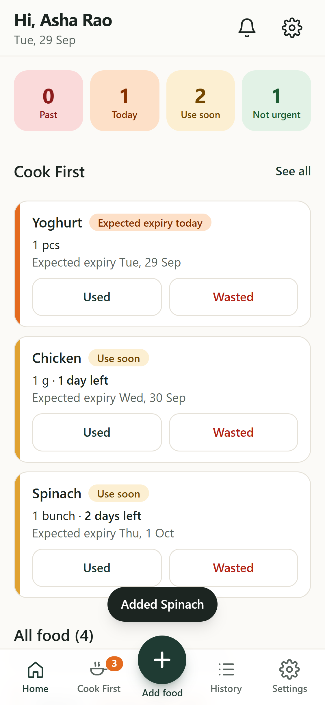
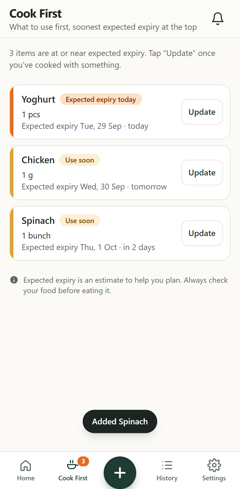
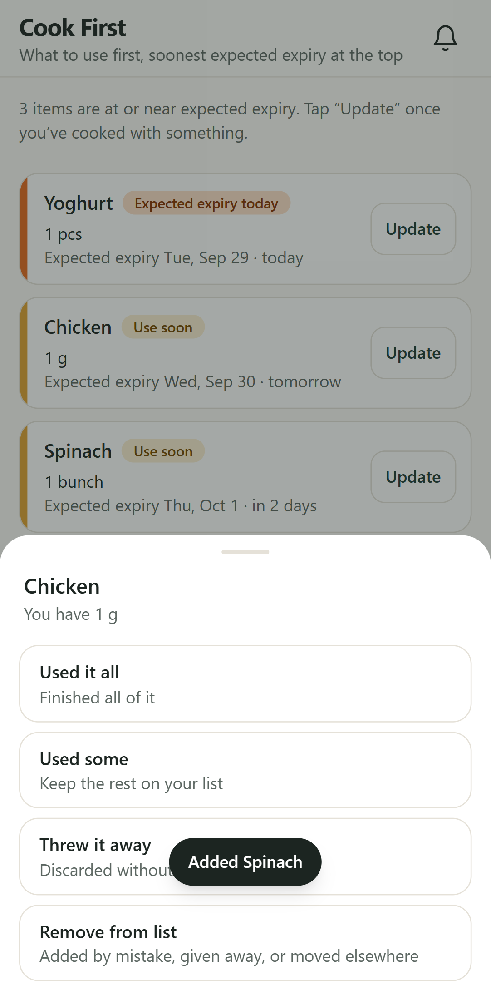
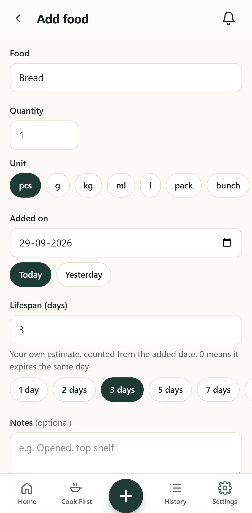
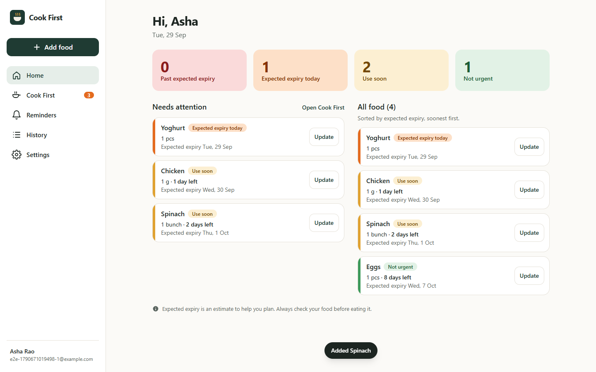
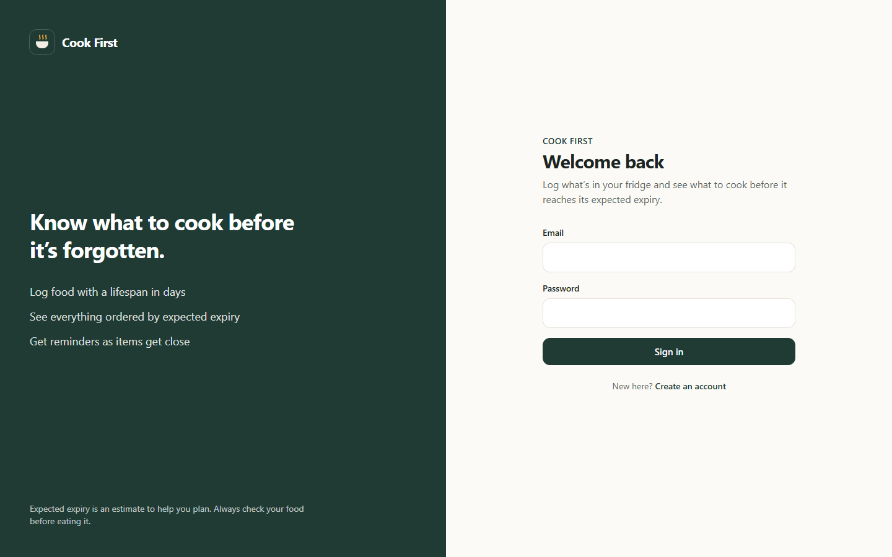

# Cook First: Perishable Food Cooking Prioritiser

A mobile-first web app that helps a household use perishable food before it goes to waste. You log each item with a lifespan in days. The app works out its **expected expiry**, sorts everything so the most urgent food comes first, and shows a daily **Cook First** list.

> **Food-safety boundary:** *Expected expiry is an estimate to help you plan. Always check your food before eating it.* The app never claims that food is fit to eat.

| | |
|---|---|
| **Status** | MVP complete. Not yet deployed. |
| **Version** | 2.2.0 (see the [Changelog](#changelog)) |
| **Requires** | Node.js 20.19 or later |
| **Specifications** | PFCP BRD v2.0, FRD v1.0, SRD v1.0, TDD v1.0 (internal documents, not stored in this repo) |
| **Repository** | `github.com/rugvailabs/cook_first` |

---

## Contents

1. [Screenshots](#screenshots)
2. [Features](#features)
3. [Tech stack](#tech-stack)
4. [Architecture](#architecture)
5. [Project structure](#project-structure)
6. [Getting started](#getting-started)
7. [Configuration](#configuration)
8. [Scripts](#scripts)
9. [Testing](#testing)
10. [How it works](#how-it-works)
11. [Dates and time zones](#dates-and-time-zones)
12. [Data model](#data-model)
13. [API reference](#api-reference)
14. [Project rules](#project-rules)
15. [Security](#security)
16. [Deployment](#deployment)
17. [Differences from the design documents](#differences-from-the-design-documents)
18. [Project status](#project-status)
19. [Changelog](#changelog)
20. [Roadmap](#roadmap)
21. [Keeping this README up to date](#keeping-this-readme-up-to-date)

---

## Screenshots

These screenshots are captured automatically by the Playwright test suite.

**Phone (Pixel 7)**

| Dashboard | Cook First | Recording what happened | Add food |
|---|---|---|---|
|  |  |  |  |

**Desktop (1440 × 900)**

| Dashboard | Sign in |
|---|---|
|  |  |

---

## Features

| Area | What it does |
|---|---|
| **Accounts** | Register and log in with email and password. JWT sessions last 7 days; passwords are hashed with bcrypt. Your time zone is captured silently from the browser at sign-up. |
| **Add food** | Name (up to 60 characters), quantity, unit (pcs, g, kg, ml, l, pack or bunch), added date, lifespan (0–365 days) and optional notes (up to 200 characters). Quick-pick buttons for units, "Today" / "Yesterday" and common lifespans. The form shows a live expected-expiry preview. There is also a "Save and add another" button. |
| **Expected expiry** | Added date + lifespan, calculated by the server's food service and never accepted from the client. It is recalculated whenever the added date or lifespan changes. A lifespan of 0 means the expected expiry is the day the item was added. |
| **Urgency** | 🟢 Not urgent (more than 3 days left) · 🟡 Use soon (1–3) · 🟠 Expected expiry today (0) · 🔴 Past expected expiry (below 0). Always shown as a colour **and** a text label. Each card also says "5 days left", "1 day left", "1 day past expected expiry" and so on. |
| **Priority order** | Sorted by expected expiry, then added date, then item ID, so the same data always gives the same order. |
| **Cook First** | Every active item that isn't "Not urgent", most urgent first. |
| **Dashboard** | Counts for each label, a "Needs attention" section and the full list of food. |
| **Recording what happened** | Used it all · Used some (reduces the quantity) · Threw it away (closes the item) · Remove. Each one is saved as a usage record. |
| **History** | Every usage record, newest first, with totals for each action. |
| **Reminders** | In-app reminders when an item reaches "Use soon", on its expected-expiry day, and the day after. Each type can be turned off. A node-cron job delivers them every 15 minutes. They count as read once you open the Reminders screen. |
| **Privacy** | Each user only ever sees their own food, history and reminders. |
| **Responsive** | Phone layout with a bottom navigation bar. From 1024 px wide: a sidebar and a two-column layout. |

---

## Tech stack

The project is a **TypeScript monorepo** using npm workspaces, with three packages: `client`, `server` and `shared`. It requires **Node.js 20.19 or later** (20.19 is the minimum that Vite and Mongoose support).

| Layer | Technology | Version |
|---|---|---|
| **Frontend** (`client`) | React | 19.3 |
| | Vite (build and dev server) | 8.3 |
| | React Router | 7.18 |
| | Tailwind CSS | 4.3 |
| | Zustand (app state; the login token is saved in `localStorage` through its `persist` middleware) | 5.0 |
| **Backend** (`server`) | Express | 5.2 |
| | Mongoose (MongoDB) | 9.10 |
| | jsonwebtoken (HS256) | 9.0 |
| | bcrypt | 6.0 |
| | zod (validation) | 4.6 |
| | node-cron (scheduled jobs) | 4.6 |
| | helmet, cors, express-rate-limit | 8.3 / 2.8 / 8.7 |
| **Shared** (`shared`) | Enums, API request and response types, zod schemas, date utilities | |
| **Language** | TypeScript | 6.0 |
| **Database** | MongoDB (docker-compose locally; MongoDB Atlas in production) | 8 |
| **Testing** | Vitest (unit) | 4.1 |
| | Supertest + mongodb-memory-server (API) | 7.3 / 11.3 |
| | Playwright (end-to-end) | 1.63 |
| | MSW (fake API in frontend tests), React Testing Library, jsdom | 2.15 / 16.3 / 27.4 |
| **Code quality** | ESLint with typescript-eslint and react-hooks | 9 |
| **CI / hosting** | GitHub Actions · Vercel (client) · any Node host, e.g. Render (server) · MongoDB Atlas | |

> **Why TypeScript 6.0, not 7?** TypeScript 7 is the new native compiler and has no JavaScript API yet, so ESLint's TypeScript support can't run on it. 6.0 is the latest version that works with ESLint.

---

## Architecture

```
client (React)  ──HTTP/JSON──▶  server (Express)  ──Mongoose──▶  MongoDB
      │                               │
      └──────── @cook-first/shared ───┘   enums · API types · zod schemas · dates.ts
```

**How a request flows through the server:**

```
routes → middleware (rate limit → JWT auth → zod validation) → controller → service → model → MongoDB
```

- **Routes** (`routes/index.ts`) only connect each path to its middleware and controller.
- **Middleware** checks the JWT and attaches the user, validates the request with a shared zod schema, and turns errors into responses.
- **Controllers** are thin: they parse the request, call one service, and send the response. There's no logic in them.
- **Services** hold all business logic: the priority engine, food actions, usage history, reminders and accounts.
- **Models** are the only code that talks to MongoDB.
- **Jobs** (`jobs/reminderJob.ts`) run the node-cron reminder sweep every 15 minutes.

**How the `shared` package is loaded:** it exports a `source` condition that points at its TypeScript source, so `tsx`, Vite and Vitest use `shared/src` directly with no separate build in development or tests. Production (`node server/dist/index.js`) uses the compiled `shared/dist`, which `npm run build` creates first.

---

## Project structure

```
cook-first/
├── shared/                     @cook-first/shared, used by both client and server
│   └── src/
│       ├── enums.ts            urgency, food status, usage action, reminder type, …
│       ├── api.ts              API request and response types
│       ├── schemas.ts          zod schemas for every request body and query
│       ├── dates.ts            todayInTz, addDays, diffDays, isValidDate, formatDisplay
│       └── dates.test.ts
├── server/                     Express API
│   └── src/
│       ├── config/             env variables, urgency thresholds, database connection
│       ├── middleware/         JWT auth, zod validation, error handling
│       ├── models/             User, FoodItem, UsageRecord, Notification (+ data migrations)
│       ├── services/           all business logic: food, usage, reminders, auth, priority engine, clock
│       ├── controllers/        thin: parse → call service → respond
│       ├── routes/             REST routes under /api
│       ├── jobs/               node-cron reminder sweep
│       ├── tests/              API, unit, rules and structure tests
│       ├── copy.ts             reminder message wording
│       ├── app.ts              Express app (helmet, CORS, JSON, routes)
│       └── index.ts            starts the database, server and jobs
├── client/                     React app
│   └── src/
│       ├── api/                API client: one function per endpoint
│       ├── stores/             Zustand stores: auth, food, notifications (+ toast)
│       ├── pages/              one file per screen (9 screens)
│       ├── components/         FoodCard, UrgencyBadge, FoodForm, ActionSheet, AppShell, AuthLayout, UI parts
│       ├── mocks/              MSW handlers for frontend tests
│       ├── lib/                small helpers: quantity/time formatting, shared-schema form checks
│       ├── test/               frontend tests
│       └── copy.ts             every piece of expiry wording in the interface
├── e2e/                        Playwright end-to-end tests
├── docs/screenshots/           screenshots used in this README
├── .github/workflows/ci.yml    CI pipeline
├── docker-compose.yml          local MongoDB
├── render.yaml                 API deployment (Render)
├── client/vercel.json          web app deployment (Vercel)
├── eslint.config.js
└── playwright.config.ts
```

---

## Getting started

### Prerequisites

- **Node.js 20.19 or later**, with npm. `.nvmrc` pins 20.19.0.
- **One of the following for the database:**
  - **Docker Desktop.** Recommended: `docker compose up -d`.
  - **Nothing.** The API can start a built-in MongoDB instead. It uses more memory, and on first run it downloads the MongoDB program (~780 MB).
  - **A MongoDB Atlas connection string.**

### Install and run

```bash
git clone https://github.com/rugvailabs/cook_first.git cook-first
cd cook-first
npm install
cp server/.env.example server/.env        # optional: the defaults work for development
```

**Database: pick one**

```bash
# A) Docker (recommended)
docker compose up -d
#    then in server/.env:
#    MONGO_URI=mongodb://localhost:27017/cook-first

# B) Built-in: leave MONGO_URI empty. Data is kept in server/.data/.
```

**Start the app.** Use two terminals:

```bash
npm run dev:server     # API     → http://localhost:4000/api
npm run dev:client     # web app → http://localhost:5173
```

Open http://localhost:5173 and create an account.

> **Running the client on a different port?** The browser calls the API directly, so add that address to `CLIENT_ORIGIN` in `server/.env`, for example `CLIENT_ORIGIN=http://localhost:5173,http://localhost:5180`.

---

## Configuration

### `server/.env`

| Variable | Default | Required in production | Description |
|---|---|---|---|
| `PORT` | `4000` | No | API port |
| `MONGO_URI` | *(empty = built-in database)* | **Yes** | MongoDB connection string |
| `JWT_SECRET` | development-only value | **Yes** | Key for signing login tokens (HS256). Generate one with `node -e "console.log(require('crypto').randomBytes(48).toString('hex'))"` |
| `JWT_EXPIRES_IN` | `7d` | No | How long a login lasts |
| `CLIENT_ORIGIN` | `http://localhost:5173` | **Yes** | The web app's address, allowed by CORS (comma-separate several) |

In production the server **refuses to start** if `MONGO_URI` or `JWT_SECRET` is missing.

### `client/.env`

| Variable | Default | Description |
|---|---|---|
| `VITE_API_URL` | `http://localhost:4000/api` | Full address of the API, for example `https://cook-first-api.onrender.com/api` |

`.env.example` files are committed for both. The real `.env` files are git-ignored.

---

## Scripts

Run these from the repository root:

| Command | What it does |
|---|---|
| `npm run dev:server` | Start the API with auto-reload |
| `npm run dev:client` | Start the Vite dev server |
| `npm run lint` | ESLint across all three packages |
| `npm run typecheck` | TypeScript check of `shared`, `server` and `client` |
| `npm test` | Unit and API tests: shared (20) + server (130) + client (32) |
| `npm run test:e2e` | Playwright end-to-end tests (12) |
| `npm run build` | Build `shared/dist`, `server/dist` and `client/dist` |

---

## Testing

| Suite | Tools | Tests | What it covers |
|---|---|---|---|
| **Dates** (`shared/src/dates.test.ts`) | Vitest | 20 | Valid and invalid dates, today in several time zones, month and year ends, daylight-saving weekends, `addDays`/`diffDays` as inverses, the "Thu, 1 Oct" format |
| **API and logic** (`server/src/tests`) | Vitest, Supertest, mongodb-memory-server | 88 | `auth`, `foods`, `notifications`, `security` and `priorityEngine` tests: registration and login, tokens, every validation message, limits and units, expiry never accepted from the client, `/use` (whole, partial, 0, negative or too much), `/waste`, `DELETE`, 409 on closed items, `/usage` paging, reminder scheduling, delivery, failures and preferences, cross-user isolation, and all the required priority-engine cases |
| **API contract** (`api.test.ts`) | Vitest, Supertest | 14 | Only the agreed error codes, never a stack trace, 500 is `INTERNAL`, database validation errors are 400, login 401 message, exact register messages, user and food response shapes, priority order and summary, `cook-first` matched before `/:id`, reminders scheduled on create and rescheduled only when dates change, pending reminders deleted on close, old routes removed |
| **Wording guard** (`foodSafetyCopy.test.ts`) | Vitest | 5 | Scans every `.ts`/`.tsx` file in `client/src`, `server/src` and `shared/src`, comments included, for the banned phrases. Fails on the word "safe" in either copy file, or on expiry wording outside the copy files. Checks the required estimate line. |
| **Project rules** (`rules.test.ts`) | Vitest, Supertest | 11 | Every database query carries the user's ID; the query-string `userId` is ignored; pure priority engine; bcrypt cost 12; passwords never returned or logged; `.env` ignored; helmet; CORS; rate limit of 20 per 15 minutes |
| **Server structure** (`structure.test.ts`) | Vitest | 12 | The `server/src` folders; thin controllers; only models talk to MongoDB; no `new Date()` in date logic; dates only from `shared`; node-cron job; env variable names and defaults; the threshold of 3 exists only in `config/urgency.ts` (checked across client, server and shared); expiry calculated in the food service with no Mongoose hook |
| **Frontend** (`client/src/test`) | Vitest, React Testing Library, MSW | 32 | Dashboard order and labels, empty state, signing out when the login expires, Cook First filter, partial use, form validation and preview, the required estimate line, all five remaining-days phrasings, colour always paired with a label, exactly seven units, notes, reminders marked read when the screen opens, plus client structure checks |
| **End-to-end** (`e2e/`) | Playwright in Chrome | 12 | 6 journeys, each run at **phone size (Pixel 7)** and **desktop size (1440×900)** |

The six end-to-end journeys:

1. Register → add food → Cook First → mark used → History
2. Partial use and partial waste
3. Validation messages and the expected-expiry preview
4. Reminders
5. One user can't see another user's food
6. Reminder settings and sign-out

Every page visited is also checked for banned wording and for sideways scrolling.

Test databases live in git-ignored `.test-db-*` folders inside the project, not the system temp folder, and are deleted afterwards. The end-to-end run uses its own ports (API 4100, web 5174), so it never touches your data.

> **Low disk space on the system drive?** Chrome creates a temporary profile for every Playwright test. If that drive is nearly full, point the temp folder elsewhere for the run. For example, in Git Bash: `TMP="$PWD/.tmp" TEMP="$PWD/.tmp" npm run test:e2e` (`.tmp/` is git-ignored).

---

## How it works

### Expected expiry and urgency

```
expiryDate    = addDays(addedDate, lifespanDays)                  calculated in services/foodService.ts
remainingDays = diffDays(today, expiryDate)                       today = todayInTz(user.timeZone)
```

| Remaining days | Urgency | Label | Colour | In Cook First | Card text |
|---|---|---|---|---|---|
| more than 3 | `NOT_URGENT` | Not urgent | green | No | "5 days left" |
| 1 – 3 | `APPROACHING_EXPIRY` | Use soon | amber | Yes | "2 days left", "1 day left" |
| 0 | `DUE` | Expected expiry today | orange | Yes | *(the label already says it)* |
| below 0 | `OVERDUE` | Past expected expiry | red | Yes | "1 day past expected expiry", "4 days past expected expiry" |

- **Urgency is calculated every time items are read and is never stored**, so it rolls over at midnight on its own.
- **The threshold of 3 is one constant**, `APPROACHING_EXPIRY_DAYS` in `server/src/config/urgency.ts`. It isn't hard-coded anywhere else, including the client's wording, and a test enforces this.
- **Urgency always has a text label as well as a colour**, on badges, summary tiles and reminders.

### Priority engine

`prioritise(items, today)` in `server/src/services/priorityEngine.ts` is a pure function with no database, Express or clock:

1. Keep only `ACTIVE` items, and add remaining days and urgency to each.
2. Sort by **expiry date** (earliest first), then **added date**, then **ID compared as strings**. `YYYY-MM-DD` strings sort in date order.
3. Return **`{ items, cookFirst, summary }`**:
   - `items`: the full sorted list
   - `cookFirst`: the `APPROACHING_EXPIRY`, `DUE` and `OVERDUE` items, in the same order
   - `summary`: the count for each urgency state, plus `total`

### Recording what happened

| Action | Request | Effect on the item | Usage record |
|---|---|---|---|
| Used it all | `POST /foods/:id/use` with no quantity (or the whole quantity) | Closed as `USED` | `USED` with the quantity that was left |
| Used some | `POST /foods/:id/use` `{quantity}` below what's left | Quantity reduced; stays active | `PARTIALLY_USED` |
| Threw it away | `POST /foods/:id/waste` | Closed as `WASTED` | `WASTED` with the quantity that was left |
| Remove | `DELETE /foods/:id` → 204 | Closed as `REMOVED` (kept, not deleted) | `REMOVED` with the quantity that was left |

Every closing action sets `closedAt` and deletes the item's pending reminders. A quantity of 0, a negative quantity, or more than is left is rejected with 400. Any action on an item that's already closed returns **409 CONFLICT "This item is no longer active."**

### Reminders

- **Up to three per item:** **approaching** (when the item becomes "Use soon"), **due** (on the day) and **overdue** (the day after).
- **Rescheduled** when an item's dates change, and **cancelled** when it's used, wasted or removed.
- **An item added late only gets the reminder for the stage it's already in**, not a burst of old ones.
- **Delivered** when the user opens the app (`GET /notifications` sends anything due first), and by the **node-cron job** (`*/15 * * * *`).
- **Failed deliveries** are saved as `FAILED` and retried up to 3 times. The food lists never depend on reminders.
- **The feed shows up to 50 reminders, `SENT` or `FAILED`, newest first**, with the unread count.
- **`readAt` stays empty until the user opens the Reminders screen.** Opening it calls `POST /notifications/read-all`. New ones still show a "New" tag during that visit.

---

## Dates and time zones

- **Every food date is a `"YYYY-MM-DD"` string, never a timestamp.** This covers `addedDate`, `expiryDate`, a reminder's `scheduledDate` and a usage record's `date`. Event times such as `sentAt` or `closedAt` are still timestamps.
- **Each user has an IANA time zone**, such as `Asia/Kolkata`. The sign-up form captures it silently from the browser, and it's updated when the user signs in.
- **The server never calls `new Date()` for date logic.** "Today" always comes from `clock.today(user.timeZone)`, which uses `todayInTz`. Only `services/clock.ts` reads the system time, and a test enforces this.
- **`shared/src/dates.ts` provides five functions**, all doing their arithmetic at **UTC midnight** so daylight-saving changes can never shift a day:

| Function | Example |
|---|---|
| `todayInTz(timeZone, now?)` | `todayInTz('Asia/Kolkata')` → `"2026-09-30"` |
| `addDays(date, n)` | `addDays('2026-09-29', 4)` → `"2026-10-03"` |
| `diffDays(from, to)` | `diffDays('2026-09-29', '2026-10-03')` → `4` |
| `isValidDate(value)` | `isValidDate('2026-02-30')` → `false` |
| `formatDisplay(date)` | `formatDisplay('2026-10-01')` → `"Thu, 1 Oct"` |

---

## Data model

MongoDB collections:

| Collection | Fields |
|---|---|
| **users** | `name` (1–50 characters), `email` (stored in lowercase, unique), `passwordHash` (bcrypt, never returned), `timeZone` (IANA, default `UTC`), `notificationPreferences {approachingExpiry, due, overdue}` (all default `true`) |
| **fooditems** | `userId` (exactly one owner), `name` (1–60), `quantity` (> 0), `unit` (`pcs`/`g`/`kg`/`ml`/`l`/`pack`/`bunch`), `addedDate` (`YYYY-MM-DD`, not in the future in the user's time zone), `lifespanDays` (whole number 0–365), `expiryDate` (= `addedDate` + `lifespanDays`), `notes` (optional, ≤ 200), `status` (`ACTIVE`/`USED`/`WASTED`/`REMOVED`, default `ACTIVE`), `closedAt` (set when it stops being active) |
| **usagerecords** | `userId`, `foodId`, `action` (`USED`/`PARTIALLY_USED`/`WASTED`/`REMOVED`), `date` (`YYYY-MM-DD` in the user's time zone), `quantityUsed`, `unit` (copied from the item), plus `foodName`, `quantityRemaining` and `createdAt` |
| **notifications** | `userId`, `foodId`, `type` (`APPROACHING_EXPIRY`/`DUE`/`OVERDUE`), `scheduledDate` (`YYYY-MM-DD`), `status` (`PENDING`/`SENT`/`FAILED`, default `PENDING`), `message`, `sentAt`, `readAt` (empty until the Reminders screen is opened), `attempts` (starts at 0), plus `expiryDate` and `lastError` |

**The expiry date is calculated in `services/foodService.ts`** when an item is created and whenever its added date or lifespan changes. There's deliberately no Mongoose hook, because hooks don't run on update queries. Any expiry date sent by the client is ignored.

**Indexes:**
- `fooditems {userId, status}` and `{userId, expiryDate}`
- `users.email` (unique)
- `notifications {userId, foodId, type, expiryDate}` (unique, so no duplicate reminders)
- `usagerecords {userId, date, createdAt}`

**Migrations:** `models/migrations.ts` runs at start-up. It converts any food dates saved by versions before 2.0 from timestamps to `YYYY-MM-DD` strings, and removes out-of-date indexes. It's safe to run repeatedly.

**Stored in the browser:** only the login token and basic profile (`localStorage`, through Zustand `persist`), cleared at sign-out.

---

## API reference

Base URL: `http://localhost:4000/api` (`VITE_API_URL`). Requests and responses are JSON. Every route except register and login (and the `/health` check) needs `Authorization: Bearer <token>`. The auth middleware attaches the user's ID, time zone and reminder preferences to the request. It returns **401** if the token is missing, invalid or expired, or if the user no longer exists. Types are in `shared/src/api.ts`, and request schemas in `shared/src/schemas.ts`.

**Responses:**
- **Users:** `{id, name, email, timeZone, notificationPreferences}`
- **Food items:** their stored fields (`id, name, quantity, unit, addedDate, lifespanDays, expiryDate, notes, status, closedAt, createdAt, updatedAt`) plus `remainingDays` and `urgency`. For a closed item, both are `null`.

| Method | Path | Body / query | Success | Errors |
|---|---|---|---|---|
| POST | `/auth/register` | `{name, email, password (8+), timeZone}` | `201 {token, user}` | 400, 409 email taken |
| POST | `/auth/login` | `{email, password}` | `200 {token, user}` | 400, 401 "Email or password is incorrect." |
| GET | `/auth/me` | | `{user}` | 401 |
| GET | `/foods` | | `{today, summary, items}`: active items in priority order; `summary` has a count for each urgency state plus `total` | 401 |
| GET | `/foods/cook-first` | | `{today, items}`: urgent items only. Registered before `/foods/:id`. | 401 |
| POST | `/foods` | `{name, quantity, unit, addedDate, lifespanDays, notes?}` | `201 FoodItem`, with reminders scheduled | 400 |
| GET | `/foods/:id` | | `FoodItem`, active or closed | 404 if missing or another user's |
| PUT | `/foods/:id` | any food fields | `FoodItem`. Changing `addedDate` or `lifespanDays` recalculates `expiryDate` and reschedules reminders. | 400, 404, 409 |
| POST | `/foods/:id/use` | `{quantity?}` | `{food, usageRecord}`: no quantity (or all of it) → `USED`; less → `PARTIALLY_USED` | 400 for 0, negative or too much; 404; 409 |
| POST | `/foods/:id/waste` | | `{food, usageRecord}`: closed as `WASTED` | 404, 409 |
| DELETE | `/foods/:id` | | `204`: soft-deleted as `REMOVED` | 404, 409 |
| GET | `/usage` | `?limit=20&offset=0` (defaults) | `{items, total, counts}`, newest first | 400 |
| GET | `/notifications` | | Sends due reminders, then `{items, unread}`: up to 50 `SENT` or `FAILED`, newest first | 401 |
| POST | `/notifications/read-all` | | `204`: all marked as read | 401 |
| PUT | `/notifications/preferences` | `{approachingExpiry?, due?, overdue?}` | preferences; pending reminders of any turned-off type are deleted | 400 |

**Also available** (used by the app):
- `GET /health`
- `PUT /auth/me` (name, time zone)
- `GET /notifications/unread-count` (the bell badge)
- `GET /notifications/preferences`

**Errors** always look like this, and never include a stack trace:

```json
{ "error": { "code": "VALIDATION_ERROR", "message": "Lifespan must be a whole number of days from 0 to 365.", "field": "lifespanDays" } }
```

| Status | Code | When |
|---|---|---|
| 400 | `VALIDATION_ERROR` | Invalid input (includes `field`). A database-level validation error is also a 400, never a 500. |
| 401 | `UNAUTHENTICATED` | Missing, invalid or expired token; deleted user; wrong email or password |
| 404 | `NOT_FOUND` | Item doesn't exist *or belongs to another user* |
| 409 | `CONFLICT` | Email already registered; "This item is no longer active." |
| 429 | `RATE_LIMITED` | More than 20 requests to `/auth/*` in 15 minutes from one IP address (from the security rules) |
| 500 | `INTERNAL` | Anything unexpected: a generic message; details are only in the server log |

**Validation messages** (defined once in `MESSAGES`, `shared/src/schemas.ts`, and used by the API and the forms):

| Field | Message |
|---|---|
| Food name | Food name is required. |
| Quantity | Quantity must be a positive number. |
| Unit | Choose a unit from the list. |
| Added date | Added date must be a valid date that isn't in the future. |
| Lifespan | Lifespan must be a whole number of days from 0 to 365. |
| Email | Enter a valid email address. |
| Password | Password must be at least 8 characters. |

---

## Project rules

These rules must never be broken. Each one is enforced in code and checked by an automated test.

| Rule | How it's enforced | Test |
|---|---|---|
| **Never suggest food is fit to eat.** The banned phrases (listed in the wording-guard test) must not appear anywhere. | All expiry wording lives in `client/src/copy.ts` (interface) and `server/src/copy.ts` (reminder messages). | `foodSafetyCopy.test.ts` scans every `.ts`/`.tsx` file in `client/src`, `server/src` and `shared/src`, ignoring case. It fails on any banned phrase, on "safe" in either copy file, or on expiry wording outside the copy files. Playwright also scans every rendered page. |
| **Add Food and Cook First show:** *"Expected expiry is an estimate to help you plan. Always check your food before eating it."* | `estimateNote` in `client/src/copy.ts`, shown by the `EstimateNote` component. | Client tests; Playwright journeys 1 and 3 |
| **Users only ever see their own data.** | The identity comes only from the verified JWT. Every query on food items, usage records and reminders includes `userId` (including `save()`/`deleteOne()`, via Mongoose's `shardKey`). Another user's item returns **404**, not 403. | `rules.test.ts` records every MongoDB operation in a full journey and fails on any without the user's ID; `security.test.ts`; Playwright journey 5 |
| **Prioritisation is deterministic.** | `prioritise(items, today)` in `services/priorityEngine.ts` is a pure function with no database, Express or clock imports. | `priorityEngine.test.ts` (running twice gives identical output; shuffled input gives the same order); `rules.test.ts` |
| **Urgency is never stored; the threshold of 3 is one constant.** | `APPROACHING_EXPIRY_DAYS` in `server/src/config/urgency.ts`. Urgency is calculated on every read. | `structure.test.ts` scans client, server and shared for a hard-coded 3 |
| **Urgency is shown with a colour and a text label, never colour alone.** | `URGENCY_STYLE` (colour) always rendered with `urgencyCopy` (label). | Client tests |
| **The expiry date is calculated in the food service and never accepted from the client.** | `foodService.ts` (no Mongoose hook). The shared schemas drop unknown fields. | `foods.test.ts`, `structure.test.ts`, client test |
| **Server-side validation is what counts.** | Shared zod schemas run in `middleware/validate.ts`. The client runs the same schemas only so errors show instantly. | `foods.test.ts`, `auth.test.ts` |
| **Passwords: bcrypt cost 12, never logged or returned.** | `services/passwordHash.ts`. Responses never include `passwordHash`. The request log records only method, route, status and time. | `rules.test.ts`, `auth.test.ts` |
| **Secrets only from environment variables.** | `config/env.ts`. `.env.example` files are committed; `.env` is git-ignored. Production refuses to start without `JWT_SECRET` and `MONGO_URI`. | `rules.test.ts`, `structure.test.ts` |
| **Helmet, CORS limited to the client, sign-in rate limit.** | `app.ts` (helmet, CORS from `CLIENT_ORIGIN`), `routes/index.ts` (20 per 15 minutes per IP address). | `rules.test.ts` |
| **Thin controllers; logic in services; only models talk to MongoDB.** | Request flow: routes → middleware → controllers → services → models. | `structure.test.ts` |
| **Food dates are `YYYY-MM-DD` strings; no `new Date()` in server date logic.** | `shared/src/dates.ts`; `services/clock.ts` is the only reader of the system time. | `dates.test.ts`, `structure.test.ts` |

---

## Security

- **Passwords:** hashed with bcrypt (cost 12) and never stored, logged or returned in plain text. A wrong email and a wrong password give the same response.
- **Login tokens:** JWT, HS256, 7-day expiry. The token carries only the user ID. Expired or tampered tokens are rejected, and the app signs the user out.
- **Access control:** the identity comes only from the verified JWT. Every query on food items, usage records and reminders includes the user's ID. Any `userId` in the body, query string or URL is ignored. Another user's item returns 404.
- **Input:** everything is checked on the server with the shared zod schemas.
- **HTTP:** Helmet headers, CORS limited to `CLIENT_ORIGIN`, a 20 KB request size limit, and `/auth/*` limited to 20 requests per 15 minutes per IP address.
- **Secrets:** read only from environment variables and never committed.

---

## Deployment

The configuration is ready but **nothing has been deployed yet**.

1. **Database: MongoDB Atlas.** Create a free cluster and copy its connection string.
2. **API: Render** (or any Node host). New → Blueprint → select this repo. `render.yaml` builds `shared` and `server`, starts `node server/dist/index.js`, checks `/api/health`, and generates `JWT_SECRET`. Set `MONGO_URI` and `CLIENT_ORIGIN`.
3. **Web app: Vercel.** Import the repo and set the root directory to `client`. Set `VITE_API_URL` to `https://<api-host>/api`.
4. **Finish up.** Put the Vercel address into `CLIENT_ORIGIN` on the API host and redeploy.

**CI** (`.github/workflows/ci.yml`) runs on every push and pull request:
- **install → lint → typecheck → unit and API tests → build**, on Node **20.19** (the minimum) and **24**
- then the Playwright end-to-end suite

---

## Differences from the design documents

| Area | Design documents say | This app does | Why |
|---|---|---|---|
| Stored status | Store `APPROACHING_EXPIRY`, `DUE` and `OVERDUE` | Store only `ACTIVE`/`USED`/`WASTED`/`REMOVED`; calculate urgency on every request | A stored urgency goes wrong at midnight |
| Urgency name | `SAFE` | `NOT_URGENT` | The app must never use the word "safe" |
| Another user's item | 403 | 404 | Doesn't reveal that the item exists |
| Usage record | `recordId, foodId, action, date, quantityUsed` | Also `userId`, name/unit copy, `quantityRemaining`, `createdAt` | History is listed per user and stays readable after later edits |
| `GET /foods` | Returns a plain list | Returns `{today, summary, items}` | The dashboard needs the counts |
| Added date | Backdating "only if intentionally supported" | Past dates allowed; future dates rejected | People log food they bought earlier |
| `EXPIRED` action | Recorded by the system | Not recorded; the item stays "Past expected expiry" until the user acts | Avoids closing items without the user knowing |
| Push notifications | Firebase (optional) | In-app reminders only | Needs a Firebase project; see the [Roadmap](#roadmap) |

---

## Project status

| Item | Status |
|---|---|
| All MVP functional requirements (FR-AUTH, FOOD, EXP, PRI, UI, NOT, USE, VAL) | ✅ Done |
| Monorepo with `client`, `server` and `shared`; Node 20.19+ | ✅ Done |
| Tests: 20 shared + 130 server + 32 client + 12 end-to-end = **194** | ✅ Passing |
| ESLint and typecheck on all packages | ✅ Clean |
| All project rules (see [Project rules](#project-rules)) | ✅ Met, each one checked by a test |
| Phone and desktop layouts | ✅ Done and checked in screenshots |
| Docker MongoDB, Render/Vercel config, CI workflow | ✅ Written. CI hasn't run yet because the code isn't on GitHub. |
| Code on GitHub (`rugvailabs/cook_first`) | ⏳ Not pushed yet: the repo is empty |
| Online deployment | ⏳ Not started |
| Opening on a phone over Wi-Fi | ⏸ Paused: the phone's requests didn't reach the PC |
| Firebase push notifications | ⏳ Not started (optional in the SRD) |

---

## Changelog

All notable changes to this project are listed here, newest first. Versions follow [Semantic Versioning](https://semver.org/).

### [Unreleased]
- *Nothing yet.*

### [2.2.0] - 2026-09-29: API contract to spec · `26b783b`
**Breaking**
- **`POST /foods/:id/use`:** now takes `{quantity?}`. No quantity (or all of it) uses the whole item; less logs `PARTIALLY_USED`; 0, negative or too much is a 400. It no longer takes `action`/`quantityUsed`.
- **`POST /foods/:id/waste`:** always closes the whole item as `WASTED`. Partial waste is gone.
- **`GET /usage-records` → `GET /usage`.**
- **`PUT /notifications/read-all` → `POST /notifications/read-all`.** `PUT /notifications/:id/read` was removed.
- **`GET /notifications`:** returns up to 50 `SENT` **or `FAILED`** reminders with the unread count, with no paging.
- **Food items return `expiryDate`** (the stored field name) instead of `expectedExpiryDate`.
- **Error codes limited to** `VALIDATION_ERROR`, `UNAUTHENTICATED`, `NOT_FOUND`, `CONFLICT`, `INTERNAL` (plus `RATE_LIMITED` from the security rules):
  - a wrong login is now `UNAUTHENTICATED`
  - a closed item is now `CONFLICT` with "This item is no longer active."

**Added**
- **`MESSAGES` in `shared`:** the exact validation messages, used by both the API and the forms.
- **Database validation errors** now return 400 `VALIDATION_ERROR` instead of 500.
- **`api.test.ts` (14 tests):** the error format and codes, no stack traces, response shapes, route order, and reminder scheduling rules.
- **More tests** for `/use`, `/waste`, `DELETE`, the 409 wording and `/usage` defaults.

**Changed**
- **Rescheduling on edit:** `PUT /foods/:id` reschedules reminders only when the added date or lifespan changes.
- **New validation messages:**
  - "Choose a unit from the list."
  - "Added date must be a valid date that isn't in the future." (for invalid and future dates alike)
  - "Lifespan must be a whole number of days from 0 to 365."
- **App:** "Threw it away" is now one tap; the Reminders list shows up to 50 reminders with no "Show older".

### [2.1.0] - 2026-09-29: Data model limits, urgency states and priority engine to spec · `3107802`
**Breaking**
- **Urgency states renamed:** `USE_SOON` → `APPROACHING_EXPIRY`, `DUE_TODAY` → `DUE`, `PAST_EXPECTED_EXPIRY` → `OVERDUE` (in API responses and `shared`).
- **`GET /foods` summary:** now includes `total`.
- **Units restricted to `pcs, g, kg, ml, l, pack, bunch`;** the free-text "Other…" unit is gone.
- **New limits:** lifespan 0–365 days (was 0–3650), food name 60 characters (was 100), user name 50 characters (was 80).

**Added**
- **Notes:** optional, up to 200 characters, on food items. Shown on cards and the details screen; editable, and cleared with an empty string.
- **Priority engine:** `prioritise(items, today)` now returns `{ items, cookFirst, summary }` (with `total`).
- **Required priority-engine tests:** a zero-day lifespan is DUE on the day it's added; running twice gives identical output; chicken, spinach, milk, eggs orders correctly with only chicken and spinach in Cook First; urgency switches exactly at 4, 3, 1, 0 and −1 days.
- **Tests for new limits and fields:** units, name/lifespan/notes limits, the name limit of 50, lowercase email and default settings.
- **Expiry never from the client:** tests show a client-sent expiry date is ignored on create and edit.
- **Structure tests:** the threshold of 3 isn't hard-coded outside `config/urgency.ts` (checked across client, server and shared); there's no Mongoose hook for expiry.
- **Client tests:** the five remaining-days phrasings; colour always paired with a label; seven units; notes; reminders read on opening.

**Changed**
- **Expiry calculation:** now done in `foodService` on create, and on edit when the added date or lifespan changes. The Mongoose `pre('validate')` hook was removed.
- **Threshold constant:** `APPROACHING_EXPIRY_DAYS = 3` in `config/urgency.ts` is the single source. Client wording no longer mentions the number.
- **Remaining-days text:** "{n} days left", "1 day left", "Expected expiry today", "1 day past expected expiry", "{n} days past expected expiry".
- **"Not urgent" colour:** now **green** (was grey). Closed items keep a neutral grey badge.
- **Reminders:** `readAt` is now set when the Reminders screen is opened. The "Mark all as read" button and tap-to-read were removed. New reminders show a "New" tag during that visit.
- **Database model limits:** `FoodItem` (name 60, unit list, quantity > 0, whole-number lifespan 0–365, notes 200) and `User` (name 50) now enforce the same rules at the database level.

### [2.0.0] - 2026-09-29: Monorepo with a shared package; layered server; calendar-date strings · `39b6a2d`
**Breaking**
- **Environment variables renamed:** `MONGODB_URI` → `MONGO_URI` and `CORS_ORIGIN` → `CLIENT_ORIGIN`. `REMINDER_SWEEP_MINUTES` was removed; the job now uses a node-cron schedule.
- **`VITE_API_URL` now defaults to `http://localhost:4000/api`.** The client calls the API directly instead of through the Vite proxy, so any client port other than 5173 must be listed in `CLIENT_ORIGIN`.
- **Food dates are stored as `"YYYY-MM-DD"` strings instead of timestamps.** Existing data is converted automatically at start-up (`models/migrations.ts`).
- **Node.js 20.19 or later required** (`engines`, `.nvmrc`).

**Added**
- **`shared` workspace package** (`@cook-first/shared`), used by both client and server:
  - enums
  - API request and response types
  - zod schemas
  - `dates.ts`, with `todayInTz`, `addDays`, `diffDays`, `isValidDate` and `formatDisplay` ("Thu, 1 Oct"), with 20 tests
- **`server/src/jobs/reminderJob.ts`:** a node-cron job running every 15 minutes.
- **Service layer:** `foodService`, `usageService`, `authService`, and read/update operations in `notificationService`. Controllers are now thin.
- **`services/clock.ts`:** the only reader of the system time; `clock.today(timeZone)` provides every "today".
- **ESLint** (typescript-eslint and react-hooks) and separate `lint` and `typecheck` scripts.
- **CI:** install, lint, typecheck, tests and build on Node 20.19 and 24, then Playwright.
- **New tests:**
  - `structure.test.ts` (11): server folders, thin controllers, only models touch MongoDB, no `new Date()` in date logic, node-cron, env names
  - client structure tests (9): folders, one page per screen, `mocks/`, API default, persisted token, shared schemas
- **Screen files:** `LoginPage.tsx` and `RegisterPage.tsx` are now separate files, sharing `components/AuthLayout.tsx`.
- **`client/src/mocks/`:** MSW handlers and server.

**Changed**
- **bcrypt:** `bcryptjs` → `bcrypt`. Hashes are identical (`$2b$12$…`), so existing accounts still sign in.
- **Tests:** moved from `server/test` into `server/src/tests`.
- **Forms:** the Add Food, Login and Register forms now check input with the shared zod schemas, so their messages match the server's exactly.
- **Date labels:** dates display as "Tue, 29 Sep" everywhere (`formatDisplay`), whatever the device's language.
- **Dependency versions, for Node 20 support:** React Router 8.4 → 7.18, Vitest 5.0 → 4.1, jsdom 30.1 → 27.4, TypeScript 7.0 → 6.0 (needed by ESLint).
- **Test databases:** now stored in git-ignored `.test-db-*` folders inside the project instead of the system temp folder.

**Fixed**
- **Reminder sweep:** it no longer uses `new Date()` for its date window; it uses the calendar day in the earliest time zone.
- **Stale item details:** an item's details could briefly show the previous item's data after moving quickly between items.
- **Escape-key handler:** the action sheet's Escape handler no longer updates a ref during render.

### [1.3.0] - 2026-09-29: Project rules enforced · `7646618`
**Added**
- **Wording guard rewritten to the rules:** scans every `.ts`/`.tsx` file in `client/src` and `server/src` (comments included) for the full list of seven banned phrases (one was missing before). It also fails on the word "safe" in either copy file, and on expiry wording outside the copy files.
- **New `rules.test.ts` (11 tests):**
  - every database query carries the user's ID
  - a query-string `userId` is ignored
  - the priority engine is pure
  - bcrypt cost 12, and passwords are never returned or logged
  - `.env` is ignored
  - helmet, CORS, and the rate limit of 20 per 15 minutes
- **Required estimate line tests:** client tests and Playwright checks for the line on Add Food and Cook First.
- **README:** rewritten as the full project reference, with a [Project rules](#project-rules) section.

**Changed**
- **All expiry wording moved into `client/src/copy.ts`:** about 20 strings from 9 screens.
- **Estimate line:** now exactly *"Expected expiry is an estimate to help you plan. Always check your food before eating it."*
- **Sign-in rate limit:** 20 requests per 15 minutes per IP address (was 30).

**Fixed**
- **Reminder queries without the user's ID:** scheduling and cancelling reminders filtered only by food ID. They now include the user's ID, as do `save()`/`deleteOne()` on food items and reminders.
- **Banned wording in comments:** comments in both copy files contained banned phrases or the word "safe".

### [1.2.0] - 2026-09-29: Desktop layout · `92176f7`
**Added**
- Desktop layout from 1024 px wide:
  - a fixed sidebar
  - a two-column dashboard
  - a two-column Cook First grid
  - reading-width forms
  - a brand panel beside the sign-in and sign-up forms
- Every Playwright journey now runs at phone size and desktop size: 12 tests.

### [1.1.0] - 2026-09-29: End-to-end tests, Docker and deployment config · `e17b113`
**Added**
- **Playwright end-to-end suite:** 6 journeys in real Chrome.
- **Local MongoDB:** `docker-compose.yml`.
- **Deployment config:** `render.yaml` and `client/vercel.json`.
- **CI:** Playwright added to the workflow.

**Fixed**
- **Sideways scrolling:** the Add food page scrolled sideways on phones.
- **Lingering errors:** error messages stayed on screen after the field was corrected.
- **Repetitive cards:** food cards said "Expected expiry" three times.

### [1.0.0] - 2026-09-29: First release (MVP) · `ed9dbc2`
**Added**
- **Accounts:** JWT sign-in, bcrypt password hashing and time-zone capture.
- **Food:** add, edit, view and remove, with expected expiry = added date + lifespan.
- **Priority and Cook First:** the priority engine, four urgency labels and the Cook First list.
- **Dashboard and history:** the dashboard, used / partly used / wasted / removed actions with usage records, and History.
- **Reminders:** in-app reminders with preferences and retries.
- **Privacy and wording:** each user sees only their own data, plus the "safe"-wording test.
- **Development:** a built-in MongoDB fallback.
- **Tests and CI:** 76 server tests, 10 client tests and a CI workflow.

---

## Roadmap

Planned or possible next steps, in rough priority order:

| # | Item | Notes |
|---|---|---|
| 1 | **Push the code to GitHub** | `git push -u origin main` from your own terminal, signed in as `rugvailabs`. CI then runs for the first time. |
| 2 | **Deploy online** | MongoDB Atlas + Render + Vercel (see [Deployment](#deployment)). This also gives phone access over HTTPS. |
| 3 | **Phone access over Wi-Fi** | Check that the phone and PC are on the same network, or use a temporary public link. |
| 4 | **Firebase push notifications** | Add a push channel to `deliveryChannel` in `services/notificationService.ts`. Needs a Firebase project and keys. |
| 5 | **Python backend (optional)** | FastAPI + Beanie + Pydantic with the same API. The React app and `shared` types wouldn't change; the SRD/TDD would need updating. |
| 6 | **Future ideas from the BRD** | Recipe suggestions, barcode and receipt scanning, shared household accounts, waste reports. |

---

## Keeping this README up to date

Every change to the project should update this file in the same commit:

1. Add an entry under **[Unreleased]** in the [Changelog](#changelog), using **Added**, **Changed**, **Fixed**, **Removed** or **Breaking**.
2. When releasing, rename **[Unreleased]** to the new version and date, then add the commit hash.
3. Update [Project status](#project-status), [Roadmap](#roadmap) and any other affected sections: features, API, configuration, test counts.
4. If the screens change, run `npm run test:e2e` and copy the new screenshots from `e2e/screenshots/` into `docs/screenshots/`.
