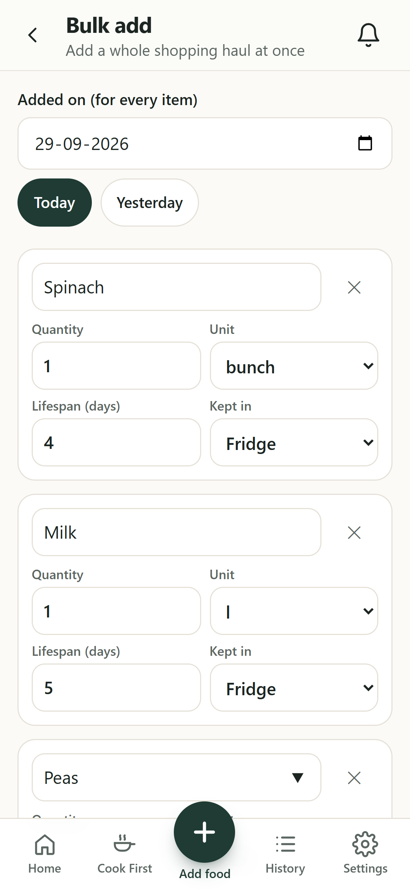
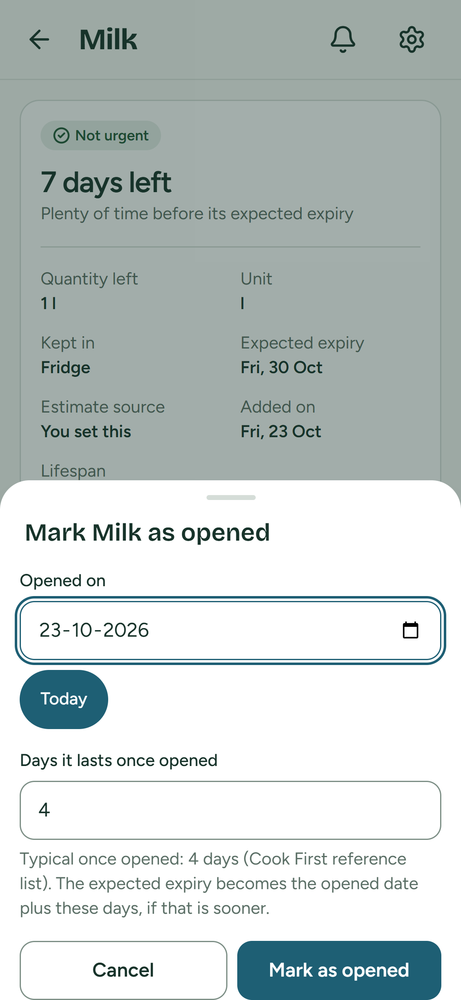
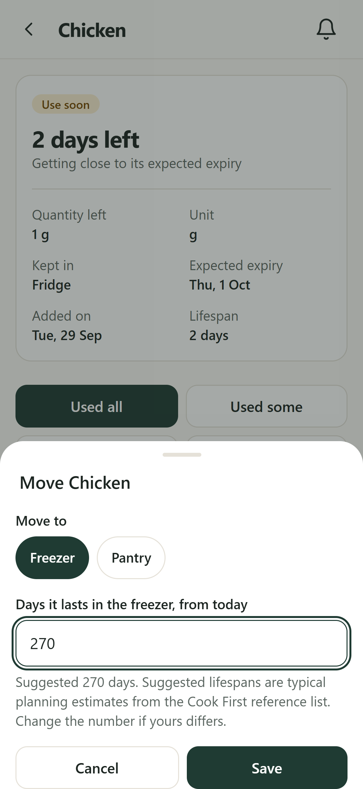
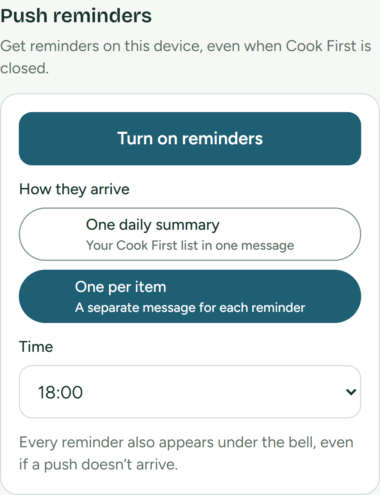
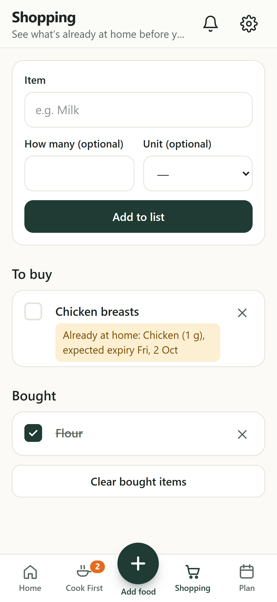
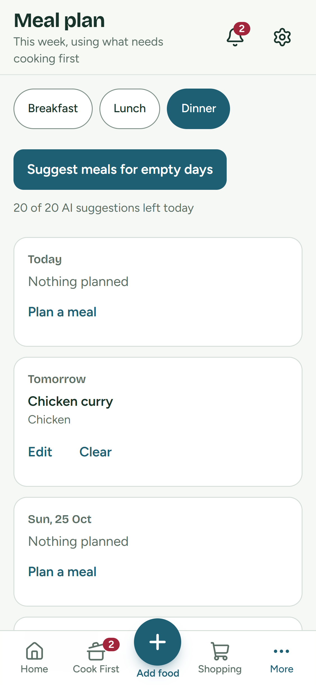
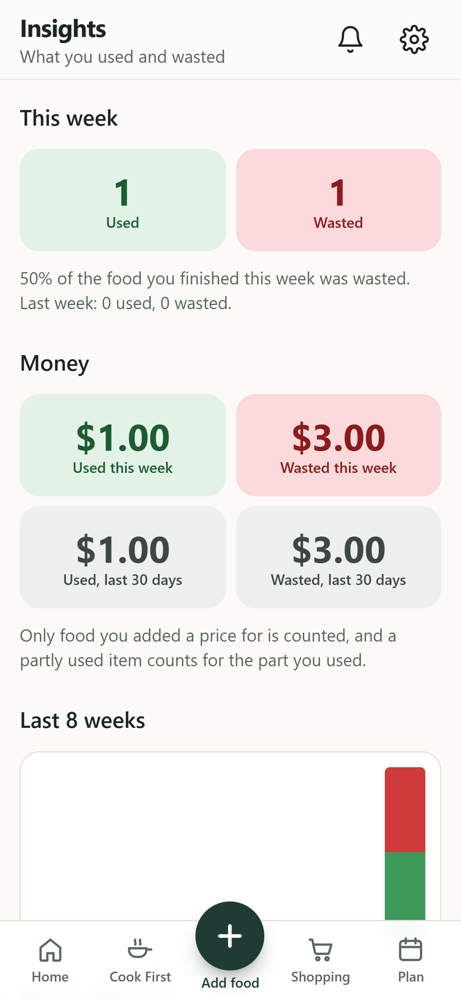
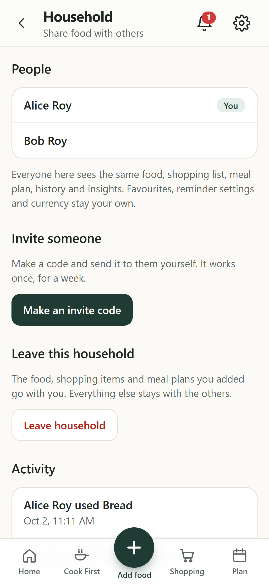
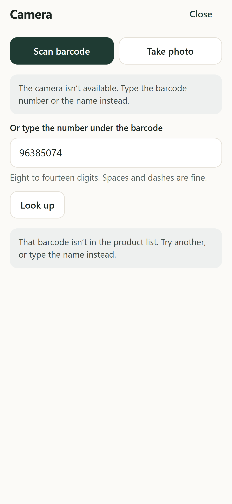
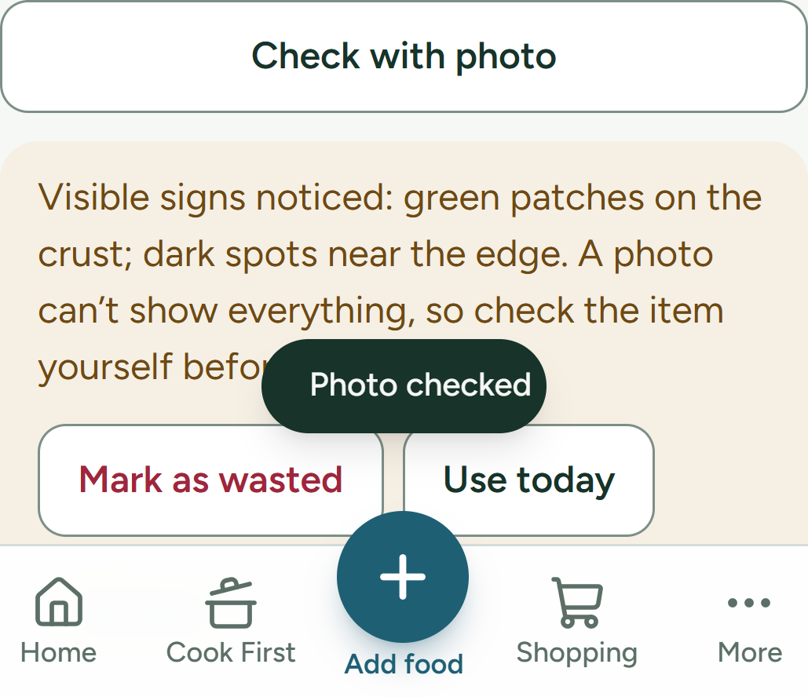

# Cook First: Perishable Food Cooking Prioritiser

A mobile-first web app that helps a household use perishable food before it goes to waste. You log each item with a lifespan in days. The app works out its **expected expiry**, sorts everything so the most urgent food comes first, and shows a daily **Cook First** list.

> **Food-safety boundary:** *Expected expiry is an estimate to help you plan. Always check your food before eating it.* The app never claims that food is fit to eat.

| | |
|---|---|
| **Status** | MVP complete; post-MVP Phases 1 (faster entry), 2 (realistic estimates), 3 (better reminders), 4 (using the food), 5 (insights) and 6 (dark mode, data export, account deletion, shared households) complete, barcode and receipt scanning, and 7 (Photo Check, behind a feature flag) complete, with a camera screen and product photos; voice entry, extra languages and grocery integrations are not built. Not yet deployed. |
| **Version** | 2.14.0 (see the [Changelog](#changelog)) |
| **Requires** | Node.js 20.19 or later |
| **Specifications** | PFCP BRD v2.0, FRD v1.0, SRD v1.0, TDD v1.0 (internal documents, not stored in this repo) |
| **Repository** | `github.com/rugvailabs/cook_first` |

---

## Contents

1. [Screenshots](#screenshots)
2. [Features](#features)
3. [Tech stack](#tech-stack)
4. [Architecture](#architecture)
5. [Project structure](#project-structure)
6. [Getting started](#getting-started)
7. [Configuration](#configuration)
8. [Scripts](#scripts)
9. [Testing](#testing)
10. [How it works](#how-it-works)
11. [Screens](#screens)
12. [Dates and time zones](#dates-and-time-zones)
13. [Data model](#data-model)
14. [API reference](#api-reference)
15. [Project rules](#project-rules)
16. [Security](#security)
17. [Deployment: HTTPS staging on real phones](#deployment-https-staging-on-real-phones)
18. [Differences from the design documents](#differences-from-the-design-documents)
19. [Build phases](#build-phases)
20. [Project status](#project-status)
21. [Changelog](#changelog)
22. [Roadmap](#roadmap)
23. [Keeping this README up to date](#keeping-this-readme-up-to-date)

---

## Screenshots

These screenshots are captured automatically by the Playwright test suite.

**Phone (Pixel 7)**

| Dashboard | Cook First | Recording what happened | Add food | Bulk add | Opened | Move | Push reminders | Shopping | Meal plan | Insights | Household | Barcode | Photo Check |
|---|---|---|---|---|---|---|---|---|---|---|---|---|---|
|  |  |  |  |  |  |  |  |  |  |  |  |  |  |

**Desktop (1440 × 900)**

| Dashboard | Sign in |
|---|---|
|  |  |

---

## Features

| Area | What it does |
|---|---|
| **Accounts** | Register and log in with email and password. JWT sessions last 7 days; passwords are hashed with bcrypt. Your time zone is captured silently from the browser at sign-up. |
| **Add food** | **Favourites** to re-add with one tap, then one short form, with suggestions from the reference list as you type and a **Kept in** dropdown: name (focused automatically), quantity (defaults to 1), a unit dropdown (defaults to pcs), added date (defaults to today, never in the future), lifespan with 1/2/3/5/7/14-day quick picks plus a number box, and optional notes behind an "Add note" link. A live preview reads, for example, "Expected expiry: Thu, 1 Oct (2 days left)", with the disclaimer beneath it. Saving returns to the dashboard with a short confirmation. |
| **Expected expiry** | Added date + lifespan, calculated by the server's food service and never accepted from the client. It is recalculated whenever the added date or lifespan changes. A lifespan of 0 means the expected expiry is the day the item was added. |
| **Urgency** | 🟢 Not urgent (more than 3 days left) · 🟡 Use soon (1–3) · 🟠 Expected expiry today (0) · 🔴 Past expected expiry (below 0). Always shown as a colour **and** a text label. Each card also says "5 days left", "1 day left", "1 day past expected expiry" and so on. |
| **Priority order** | Sorted by expected expiry, then added date, then item ID, so the same data always gives the same order. |
| **Cook First** | Every active item that isn't "Not urgent", most urgent first. |
| **Dashboard** | A header with your name, a bell with the unread count and a settings icon. Then a summary bar (past, today, use soon, not urgent); a Cook First section with the top 3 urgent items and a "See all" link ("Nothing urgent right now." when empty); and the full list in priority order ("Your fridge is empty. Add your first item." when empty). A fixed **Add food** button is always in reach. |
| **Recording what happened** | On the details screen: **Used all · Used some · Wasted · Remove**. Each card has **Used** (all or some) and **Wasted** buttons. Actions happen at once and the message offers **Undo** for a few seconds (the server allows undo for 10 minutes). "Used some" asks for a quantity. Each action is saved as a usage record. |
| **History** | Every usage record, newest first, showing the food, action, quantity and date, with totals for each action and a "Load more" button. |
| **Reminders** | In-app under the bell, always. Sent 3 days before expiry, on the expiry day, and the day after. Each type can be turned off in Settings. They're delivered whenever you open the dashboard or the Reminders screen, and by an hourly job. They count as read once you open the Reminders screen. |
| **Camera screen** | The **first option on Add Food** is **Use the camera**, with typing it in yourself just below. The camera screen has two modes. **Scan barcode** reads codes **live from the camera** (the browser's `BarcodeDetector` where it has one; otherwise `@zxing/browser`, which also covers Safari on an iPhone) and always offers **typing the number** under the barcode. A code (its check digit is verified) is looked up on the **server** in **Open Food Facts** (free, no key) for the name, first brand and pack size. **Take photo** (only when Photo Check is on) uses a file input with `capture="environment"`, so it opens the camera on a phone, **including an iPhone**, and a file chooser on a computer; the AI names the food and gives its kind. Every find joins a **Scanned so far** list, so a whole shop can be scanned in a row. **One item** fills in Add Food, with the **catalog lifespan suggestion** (your own usual first, then the reference list) for you to confirm; **several** become a **Bulk Add list** to check and put away together (Bulk Add also has **Scan more**). If the camera is **denied or missing**, a short message says so and typing the number still works. Warning signs the AI sees in a photo are shown as a note; acting on them stays with Photo Check on Food Details. |
| **Receipt scanning** | With AI on, **Scan a receipt** on Bulk add takes a photo, scales it to 1600 px in the browser and sends it to Claude, which returns the **food lines only** (name, quantity, unit, price, and the shopping date if clear). They become rows to check: lifespans are suggested from your usual ones, then the reference list, and **nothing is saved until you press Add**. The photo is used for that one request and never stored or logged; each scan counts toward the 20 daily AI requests. |
| **Photo Check** | Behind a feature flag (`PHOTO_CHECK=on`) and only when AI is on; otherwise **no photo controls are shown**. **Check with photo** on Food Details (naming a new food from a photo happens on the camera screen's Take photo). The photo is scaled to 1600 px in the browser and sent to Claude, which returns a **name, category, confidence and visible warning signs** (`MOULD`, `DISCOLOURATION`, `WILTING`, `SLIME`, `BRUISING`, `DAMAGED_PACKAGING`, `SWOLLEN_PACKAGING`, `OTHER`); the answer has **no field for good or normal condition**, and anything outside that shape is refused. A name is only used from **0.6 confidence** (one constant in `shared`); below that you are asked to try again or type it. **Warning signs:** "Visible signs noticed: …. A photo can’t show everything, so check the item yourself before using it." with **Mark as wasted**, **Use today** (asks first; shown only when the expected expiry is later than today, so it can only ever move earlier) and **Dismiss**. **No signs: nothing about condition is shown**, only a neutral "Photo checked". Nothing changes without your confirmation, each check counts toward the 20 daily AI requests, all AI text (including each warning) is checked for banned wording, the photo sent for checking is never stored or logged, and each check is recorded in the household activity log as who checked which food (never the photo or the result). |
| **Product photos** | A photo taken on the camera screen is **kept with the food** once the food is saved (one photo per item; a new one replaces the old). The server **checks the real file type** (JPEG, PNG or WebP only, from the first bytes, not the name), refuses files over **5 MB**, and **re-encodes** the picture with `sharp` to a **WebP of at most 1280 px plus a 320 px thumbnail**, which **removes all EXIF data, including the GPS location**. Both are stored in a MongoDB **GridFS** bucket named `foodPhotos` (never a folder or a public URL) with the household, the food and who uploaded it. They are served only by `GET /api/foods/:id/photo?size=thumb|full`, to a **signed-in member of the household** (404 otherwise), with `Cache-Control: private` and `X-Content-Type-Options: nosniff`. Because an image tag can't send the login token, the app fetches each photo with the token and shows it through an **object URL that is revoked** when its card goes away. **Thumbnails** show on food cards, the **full photo** on Food Details with **Change photo** and **Remove photo**, and **Save product photos** in Settings (on by default) turns keeping them off. Photos are **deleted 30 days after the item is closed** (used, wasted or removed), **at once when you delete your account**, and move with the food when someone joins or leaves a household. Uploads are rate-limited, and **receipt photos are never stored**. |
| **Barcode look-up** | The **server** looks a barcode up in Open Food Facts (a `ProductClient` interface, 5 second time-out, a user agent that says who is asking) and returns the name, first brand and pack size (cl and dl converted to ml). Not found, an unreachable database and a name that would break the wording rules all just ask you to type the name. |
| **Faster entry** | A **reference list of 43 common foods** with suggested lifespans for fridge, freezer and pantry. It suggests as you type, fills in the unit and lifespan, and the user can always change the number. **Favourites** save a food and re-add it with one tap. **Bulk add** handles a whole shopping haul (up to 50 items) in one go. |
| **Where it's kept** | Every item is kept in the **Fridge**, **Freezer** or **Pantry**, and can record an **opened date**. |
| **Realistic estimates** | **Opened** (on the details screen) records the opened date and a days-once-opened value, prefilled from the reference list. The expected expiry becomes the opened date plus those days, but only if that's sooner; opening never makes it later. "Mark as not opened" (or Undo) puts it back. **Move** sends an item to another location and recalculates the expected expiry from today, using that location's suggested lifespan. **Your usual lifespans:** once you've entered the same food in the same location at least twice, Add Food and Bulk add suggest the median of your last 10 (marked ★), ahead of the reference list. |
| **Leftovers** | Add Food has **"These are leftovers"**: it suggests a short lifespan (3 days in the fridge or pantry, 60 in the freezer, from the reference list) and allows **at most 4 days unless frozen**, checked on the server too. Leftovers carry a **Leftovers** tag. "Save leftovers" on a recipe idea opens Add Food with the name filled in. |
| **Shopping list** | Add items (optional quantity and unit), tick them off and clear bought ones. Each item to buy **warns about matching food already at home**, e.g. "Already at home: Chicken (500 g), expected expiry Wed, 30 Sep", linking to that item. Matching is word by word and ignores plurals ("milk" matches "Oat milk"). |
| **Meal plan** | Today and the next six days. Plan a meal for any day with a title and, optionally, the food it uses (chosen from your food in Cook First order). Food that has since been used up is marked "no longer at home". |
| **AI (optional)** | With `ANTHROPIC_API_KEY` set, **Recipe ideas** on Cook First (up to 3, each using at least one Cook First item, ordered by the most urgent item they use) and **Suggest meals for empty days** on the plan (a draft; nothing is saved until you add it). 20 AI requests per user per day. AI reads the Cook First order and never changes it. Every answer is checked with zod and for banned wording (asked for again up to 3 times). |
| **Push reminders** | The app is **installable** (web app manifest, icons, service worker). In Settings, **Turn on reminders** asks for notification permission only when tapped, then registers this browser with the server. Reminders arrive as **one daily summary** of the Cook First list (the default) or **one per item**, at an hour you choose (default 08:00 in your time zone). Per-item notifications have **Used** and **Snooze** buttons; if a button can't be completed, the notification opens Food Details instead. Snooze leaves the item out of push reminders until tomorrow. On an iPhone, Settings explains that the app must be added to the Home Screen first. If push fails or isn't available, reminders still appear in the app. |
| **Insights** | **Used versus wasted** this week with the waste rate and last week for comparison, an eight-week bar chart (with a table for screen readers), the foods you waste most in the last 30 days, and plain tips. An **optional price** on each item gives **money saved and lost** (a partly used item counts for the part used; a removal counts for nothing). Tips talk about habits and amounts bought, never about whether food can be eaten, and the AI is not involved. |
| **Dark mode** | **Appearance** in Settings: System (follows the device, the default), Light or Dark. The choice is kept on this device and applied before the first paint, so there is no flash. Dark colours are the same tokens with dark values (`client/src/index.css`), so urgency is still a colour plus a text label. |
| **Your data** | **Download my data** saves everything the app holds about you (account, food, history, reminders, favourites, shopping list and meal plan) as one JSON file. It never includes the password hash or push keys. **Delete my account** asks for your password again, then permanently deletes the account and every record it owns. |
| **Settings** | Your name and email (read-only), a currency for prices, **Save product photos**, an Appearance choice, Download my data and Delete my account, switches for the three reminder types, push reminders for this device (on/off, daily summary or one per item, and the time), links to Insights and History, and Log out. Logging out turns push off for that account on this device. |
| **Households** | Everyone is in a household, alone until they invite someone. **Invite someone** makes a single-use code (shown as XXXX-XXXX, valid for a week, nothing is emailed) that you send by hand; **Join a household** takes that code. Up to 6 people share the **food, usage history and insights, shopping list and meal plan**, and each member gets reminders for the shared food. **Favourites, reminder settings, currency, AI allowance and push devices stay personal.** Joining brings your own food, history, list and plan into the household (on a day both have a meal planned, the household's stays). **Leave household** takes what you added (and the history of that food) with you and starts a new household; everything else stays. An **activity log** shows who added, used, wasted or removed what, who checked food with a photo, and who joined or left. |
| **Privacy** | You only ever see your own household's food, history, lists and reminders, and your own favourites. Another household's data is indistinguishable from missing (404). |
| **Responsive** | Mobile-first and tested at **375 px** wide, with every button, link and field at least 44 px tall. From 1024 px wide: a sidebar and a two-column layout. Every screen has loading, empty and error states, and any 401 signs you out and returns you to the login page. |

---

## Tech stack

The project is a **TypeScript monorepo** using npm workspaces, with three packages: `client`, `server` and `shared`. It requires **Node.js 20.19 or later** (20.19 is the minimum that Vite and Mongoose support).

| Layer | Technology | Version |
|---|---|---|
| **Frontend** (`client`) | React | 19.3 |
| | Service worker + web app manifest (installable app, push notifications; no extra library) | |
| | Vite (build and dev server) | 8.3 |
| | React Router | 7.18 |
| | Tailwind CSS | 4.3 |
| | @zxing/browser (reads barcodes from the camera where the browser has no `BarcodeDetector`; loaded only when needed) | 0.2 |
| | Zustand (app state; the login token is saved in `localStorage` through its `persist` middleware) | 5.0 |
| **Backend** (`server`) | Express | 5.2 |
| | Mongoose (MongoDB) | 9.10 |
| | jsonwebtoken (HS256) | 9.0 |
| | bcrypt | 6.0 |
| | zod (validation) | 4.6 |
| | node-cron (scheduled jobs) | 4.6 |
| | multer (photo uploads, held in memory, 5 MB limit) / sharp (checks and re-encodes photos) | 2.4 / 0.35 |
| | web-push (self-hosted Web Push with VAPID keys) | 3.6 |
| | @anthropic-ai/sdk (Claude API, structured JSON outputs); model `claude-sonnet-5-5` | 0.129 |
| | helmet, cors, express-rate-limit | 8.3 / 2.8 / 8.7 |
| **Shared** (`shared`) | Enums, API request and response types, zod schemas, date utilities | |
| **Language** | TypeScript | 6.0 |
| **Database** | MongoDB (docker-compose locally; MongoDB Atlas in production) | 8 |
| **Testing** | Vitest (unit) | 4.1 |
| | Supertest + mongodb-memory-server (API) | 7.3 / 11.3 |
| | Playwright (end-to-end) | 1.63 |
| | MSW (fake API in frontend tests), React Testing Library, jsdom | 2.15 / 16.3 / 27.4 |
| **Code quality** | ESLint with typescript-eslint and react-hooks; Prettier | 9 / 3 |
| **CI / hosting** | GitHub Actions · Vercel (client) · any Node host, e.g. Render (server) · MongoDB Atlas | |

> **Why TypeScript 6.0, not 7?** TypeScript 7 is the new native compiler and has no JavaScript API yet, so ESLint's TypeScript support can't run on it. 6.0 is the latest version that works with ESLint.

---

## Architecture

```
client (React)  ──HTTP/JSON──▶  server (Express)  ──Mongoose──▶  MongoDB
      │                               │
      └──────── @cook-first/shared ───┘   enums · API types · zod schemas · dates.ts
```

**How a request flows through the server:**

```
routes → middleware (rate limit → JWT auth → zod validation) → controller → service → model → MongoDB
```

- **Routes** (`routes/index.ts`) only connect each path to its middleware and controller.
- **Middleware** checks the JWT and attaches the user, validates the request with a shared zod schema, and turns errors into responses.
- **Controllers** are thin: they parse the request, call one service, and send the response. There's no logic in them.
- **Services** hold all business logic: the priority engine, food actions, usage history, reminders and accounts.
- **Models** are the only code that talks to MongoDB.
- **Jobs** (`jobs/reminderJob.ts`) run the node-cron reminder sweep every 15 minutes.

**How the `shared` package is loaded:** it exports a `source` condition that points at its TypeScript source, so `tsx`, Vite and Vitest use `shared/src` directly with no separate build in development or tests. Production (`node server/dist/index.js`) uses the compiled `shared/dist`, which `npm run build` creates first.

---

## Project structure

```
cook-first/
├── shared/                     @cook-first/shared, used by both client and server
│   └── src/
│       ├── enums.ts            urgency, food status, usage action, reminder type, …
│       ├── api.ts              API request and response types
│       ├── schemas.ts          zod schemas for every request body and query
│       ├── dates.ts            todayInTz, addDays, diffDays, isValidDate, formatDisplay
│       └── dates.test.ts
├── server/                     Express API
│   └── src/
│       ├── config/             env variables, urgency thresholds, database connection
│       ├── middleware/         JWT auth, zod validation, error handling
│       ├── models/             User, FoodItem, UsageRecord, Notification (+ data migrations)
│       ├── services/           all business logic: food, usage, reminders, auth, priority engine, clock
│       ├── controllers/        thin: parse → call service → respond
│       ├── routes/             REST routes under /api
│       ├── jobs/               node-cron reminder sweep
│       ├── tests/              API, unit, rules and structure tests
│       ├── copy.ts             reminder message wording
│       ├── app.ts              Express app (helmet, CORS, JSON, routes)
│       └── index.ts            starts the database, server and jobs
├── client/                     React app
│   └── src/
│       ├── api/                API client: one function per endpoint
│       ├── stores/             Zustand stores: auth, food, notifications (+ toast)
│       ├── pages/              one file per screen (9 screens)
│       ├── components/         FoodCard, UrgencyBadge, FoodForm, ActionSheet, AppShell, AuthLayout, UI parts
│       ├── mocks/              MSW handlers for frontend tests
│       ├── lib/                small helpers: quantity/time formatting, shared-schema form checks
│       ├── test/               frontend tests
│       └── copy.ts             every piece of expiry wording in the interface
├── e2e/                        Playwright end-to-end tests
├── docs/screenshots/           screenshots used in this README
├── .github/workflows/ci.yml    CI pipeline
├── docker-compose.yml          local MongoDB
├── render.yaml                 API deployment (Render)
├── client/vercel.json          web app deployment (Vercel)
├── eslint.config.js
└── playwright.config.ts
```

---

## Getting started

### Prerequisites

- **Node.js 20.19 or later**, with npm. `.nvmrc` pins 20.19.0.
- **One of the following for the database:**
  - **Docker Desktop.** Recommended: `docker compose up -d`.
  - **Nothing.** The API can start a built-in MongoDB instead. It uses more memory, and on first run it downloads the MongoDB program (~780 MB).
  - **A MongoDB Atlas connection string.**

### Install and run

```bash
git clone https://github.com/rugvailabs/cook_first.git cook-first
cd cook-first
npm install
cp server/.env.example server/.env        # optional: the defaults work for development
```

**Database: pick one**

```bash
# A) Docker (recommended)
docker compose up -d
#    then in server/.env:
#    MONGO_URI=mongodb://localhost:27017/cook-first

# B) Built-in: leave MONGO_URI empty. Data is kept in server/.data/.
```

**Start the app.** Use two terminals:

```bash
npm run dev:server     # API     → http://localhost:4000/api
npm run dev:client     # web app → http://localhost:5173
```

Open http://localhost:5173 and create an account. For a ready-made login with sample food, run `npm run seed -w server` while the API is running (it prints the email and password).

**If `npm run dev:server` won't start:**

| What you see | Why, and what to do |
|---|---|
| `ERR_MODULE_NOT_FOUND: Cannot find package '…\node_modules\@cook-first\shared\index.js'`, or Vite saying it `Cannot find native binding` or `lightningcss.win32-x64-msvc.node` | `node_modules` is damaged, usually after the project folder was moved or copied while a copy was interrupted (a workspace link or a native file ends up empty). Delete `node_modules` (the root one and the ones inside `client`, `server` and `shared`) and run `npm ci`. |
| `DBPathInUse: Unable to create/open the lock file … server\.data\mongod.lock` | Another API is already using the embedded database in `server/.data`. Stop it first (it listens on port 4000, with its database on 27027), or set `MONGO_URI`. |
| `EADDRINUSE` on port 4000 or 5173 | Something else is on that port. Stop it, or change `PORT` / the Vite port (and `CLIENT_ORIGIN`, see above). |

> **Running the client on a different port?** The browser calls the API directly, so add that address to `CLIENT_ORIGIN` in `server/.env`, for example `CLIENT_ORIGIN=http://localhost:5173,http://localhost:5180`.

---

## Configuration

### `server/.env`

| Variable | Default | Required in production | Description |
|---|---|---|---|
| `PORT` | `4000` | No | API port |
| `MONGO_URI` | *(empty = built-in database)* | **Yes** | MongoDB connection string |
| `JWT_SECRET` | development-only value | **Yes** | Key for signing login tokens (HS256). Generate one with `node -e "console.log(require('crypto').randomBytes(48).toString('hex'))"` |
| `JWT_EXPIRES_IN` | `7d` | No | How long a login lasts |
| `CLIENT_ORIGIN` | `http://localhost:5173` | **Yes** | The web app's address, allowed by CORS (comma-separate several) |
| `VAPID_PUBLIC_KEY` | *(empty)* | For push | Web Push public key. The only key the client ever sees (`GET /push/config`). |
| `VAPID_PRIVATE_KEY` | *(empty)* | For push | Web Push private key. Secret; never leaves the server. |
| `VAPID_SUBJECT` | *(empty)* | For push | Contact for push services, a `mailto:` or `https:` URL |

| `ANTHROPIC_API_KEY` | *(empty)* | For AI | Claude API key. AI features are on only when it is set. **Put it in `server/.env` only**, which is git-ignored. |
| `PHOTO_CHECK` | *(empty = off)* | No | Set to `on` to turn on Photo Check. It also needs `ANTHROPIC_API_KEY`; with either missing no photo controls are shown. |
| `ANTHROPIC_BASE_URL` | *(empty = Anthropic)* | No | Read by the Anthropic SDK. Only the end-to-end tests set it, to a local stand-in. |
| `PRODUCT_LOOKUP_URL` | *(empty = Open Food Facts)* | No | Where barcodes are looked up. Only the end-to-end tests change it, to a local stand-in. |
| `AI_MODEL` | *(empty = `claude-sonnet-5-5`)* | No | Claude model ID. The default was checked against Anthropic's models overview on 2026-09-30. |

Generate the VAPID key pair once with `npm run vapid:keys -w server`. Push is switched on only when all three VAPID variables are set; without them, reminders stay in-app and Settings says push isn't set up. **Tests never use a real AI key:** the server ignores `ANTHROPIC_API_KEY` when `NODE_ENV` is `test`, and the end-to-end API is started with it empty.

In production the server **refuses to start** if `MONGO_URI` or `JWT_SECRET` is missing.

### `client/.env`

| Variable | Default | Description |
|---|---|---|
| `VITE_API_URL` | `http://localhost:4000/api` | Full address of the API, for example `https://cook-first-api.onrender.com/api` |

`.env.example` files are committed for both. The real `.env` files are git-ignored.

---

## Scripts

Run these from the repository root:

| Command | What it does |
|---|---|
| `npm run dev:server` | Start the API with auto-reload |
| `npm run dev:client` | Start the Vite dev server |
| `npm run lint` | ESLint across all three packages |
| `npm run format` / `npm run format:check` | Format with Prettier / check formatting (CI runs the check) |
| `npm run typecheck` | TypeScript check of `shared`, `server` and `client` |
| `npm run seed -w server` | With the server running, create a demo account (`demo@cookfirst.local` / `cookfirst-demo`) with 10 priced sample items at every urgency level, plus 5 used or wasted ones so Insights has data. Add `-- --reset` to re-seed. |
| `npm run vapid:keys -w server` | Generate a Web Push (VAPID) key pair for `server/.env` |
| `npm test` | Unit and API tests: shared (30) + server (375) + client (164) |
| `npm run test:e2e` | Playwright end-to-end tests (34), at 375 px and 1440 px |
| `npm run build` | Build `shared/dist`, `server/dist` and `client/dist` |

---

## Testing

| Suite | Tools | Tests | What it covers |
|---|---|---|---|
| **Dates and reference list** (`shared/src/*.test.ts`) | Vitest | 30 | Valid and invalid dates, the hour in a time zone (for push timing), leap years (including 2000 and 2100), today in several time zones, month and year ends, daylight-saving weekends, `addDays`/`diffDays` as inverses, the "Thu, 1 Oct" format; the reference list (unique names, valid units, 0–365 lifespans, freezer longer than fridge, search) |
| **API and logic** (`server/src/tests`) | Vitest, Supertest, mongodb-memory-server | 107 | `auth`, `foods`, `notifications`, `security` and `priorityEngine` tests: registration and login, tokens, every validation message, limits and units, expiry never accepted from the client, `/use` (whole, partial, 0, negative or too much), `/waste`, `DELETE`, 409 on closed items, `/usage` paging, each reminder scheduling rule (including a zero-day lifespan), the three exact messages, `dispatchDue` on `GET /foods`, a dispatch failure never breaking the inventory or Cook First, `{n}` worked out at send time, delivery, failures and preferences, cross-user isolation, and all the required priority-engine cases |
| **Phase 1** (`phase1.test.ts`) | Vitest, Supertest | 18 | Household, storage and opened-date fields (defaults, validation, editing, backfill of existing data); bulk add (shared date, per-row storage, reminders, the failing row's field path, all-or-nothing, 1–50 limit); favourites (create, duplicate 409, one-tap add, delete, privacy); undo for every action (quantity, status, reminders and usage record restored; stepping back; nothing to undo; 10-minute limit; other users get 404) |
| **Phase 2** (`phase2.test.ts`) | Vitest, Supertest | 16 | Opened: milk shortens to its typical 4 days and reminders move; opening never lengthens the expiry; custom days and past opened dates; 400 when there's no typical value; 409 when already opened or closed; invalid dates; mark as not opened restores the lifespan. Move: chicken to the freezer and back, custom days, the 365-day cap, 400 for no freezer value, the same location or bad days, 404 for another user. Learned lifespans: median of your entries per food and location, at least 2 needed, closed items count, only the last 10, never another user's, backfill |
| **Phase 3** (`phase3.test.ts`) | Vitest, Supertest, a fake `PushProvider` | 30 | Only the VAPID public key is exposed (null when push isn't set up); subscriptions store user, endpoint, keys, browser and last use, re-subscribing updates, https endpoints only, users can only remove their own; delivery settings (daily summary at 08:00 by default, one per item, hour 0–23); the digest waits for the user's hour in their own time zone, goes out once a day, lists the Cook First items in Cook First order ("and N more" after 4), is skipped when nothing needs attention, and never changes the order; one push per item with Used and Snooze and a Food Details link, sent to every browser; 404/410 deletes the subscription, other errors keep it and in-app reminders still arrive; Used closes the item with a usage record; Snooze drops it from today's summary and brings it back tomorrow (and re-pushes it in per-item mode); bad or login tokens rejected, action tokens can't sign in or touch another user's item; the web-push provider's payload, VAPID keys and 404/410 handling |
| **Product photos** (`photos.test.ts`) | Vitest, Supertest, `sharp` fixtures | 34 | Needs sign-in; JPEG, PNG and WebP kept as WebP in two sizes, `photoAt` on the food list, a big photo scaled to 1280 px with a 320 px thumbnail and a small one never enlarged; **rejected:** a text file, PDF, GIF, SVG with a script, HTML or a bare RIFF whatever type they claim, a corrupt JPEG, a missing, empty or wrongly named file, **a file over 5 MB (413)**, a decompression bomb, food that is closed, and photos turned off; the 61st upload in 15 minutes is a 429; **GPS stripped:** a fixture with a real GPS location, camera make and a note ends with no EXIF block, no EXIF chunk and none of those words, orientation applied; served privately with `private` and `nosniff`, the full size by default; **another household gets 404** for every action and nothing changes; no folder serving or disk writes anywhere in the source; **replacement** leaves exactly two files and no orphan chunks; removal; metadata (household, food, uploader); shared households; **automatic deletion** after 30 days (kept at 29 and 30, deleted at 31, for wasted, used and removed food), never for active food, kept after Undo, orphans removed; **account deletion** removes a household's photos at once, and in a shared household the photos of what they added or uploaded but not anyone else's; photos follow food when someone joins or leaves; receipts are never stored |
| **Photo Check** (`photo.test.ts`) | Vitest, Supertest, a fake `AiClient` | 23 | Needs sign-in; off when the flag is off or AI is off (and `photoCheck` in the status says so); bad photos and ids rejected before the AI; the photo reaches the AI with a problems-only prompt; the schema has only name, category, confidence and warning signs; an answer with an extra field, a type that is not a problem, a bad confidence or an empty name is refused, retried and refunded; banned wording in a name or any warning is retried and never returned; counts toward the daily limit; a large photo accepted and never stored anywhere; nothing is added or changed by a check; a photo of an item at home must be one of the household's; the activity log records who checked which food and never the result; no event for a failed check. **Use today:** brings a later expected expiry forward, is a 409 for an item already due or overdue, closed, or in another household, can never move an expiry later (checked over many items), reschedules reminders and leaves the entered lifespan alone |
| **Scanning** (`scanning.test.ts`) | Vitest, Supertest, a fake `ProductClient` and `AiClient` | 25 | Barcode: sign-in needed, bad numbers rejected before any look-up, name/brand/pack size returned, spaces and dashes dropped, cl and dl converted to ml, unknown units left blank, "not found" is a normal answer, banned-wording names hidden, long names cut to 60, a failed look-up is a 503 that leaks nothing; the Open Food Facts client (URL, fields, user agent, time-out, 404 and status 0, bad fields). Receipts: sign-in and AI needed, bad photos rejected before the AI, the photo reaches the AI with the receipt prompt, rounded draft returned and nothing saved, future or invalid dates blanked, counts toward the daily limit, retried then refunded when unusable, banned wording retried, a 3.9 MB photo accepted on this route only and never stored in any collection, over-size refused; bulk add keeps per-row prices |
| **Households** (`household.test.ts`) | Vitest, Supertest | 28 | Everyone starts alone; invite codes (format, one week, limits, cancelling only your own); joining (lower case and dashes, unknown, empty, out-of-date, own, already-shared and full cases; a code works once); your food, list and plan come with you and the household's meal wins on a shared day; members see and act on the same food, history and insights; each member gets reminders, including for food that came with a new member; favourites and currency stay personal; another household sees none of it (404s); the activity log (who did what, newest first, paging); leaving splits food, list, plan and history correctly and drops reminders for food left behind; deleting an account in a shared household removes only that person's food; existing data is given its owner's household at start-up |
| **Phase 6** (`phase6.test.ts`) | Vitest, Supertest | 7 | Export needs sign-in; it returns food, history, favourites, shopping and meal plan as a download, never the password hash, internal ids or another user's data; deleting needs the password (a wrong one is a 400, deletes nothing and keeps you signed in), removes the account and every record it owns while leaving other accounts alone, and lets the same email register again |
| **Phase 5** (`phase5.test.ts`) | Vitest, Supertest | 20 | Optional price (validation, edit, clear); a partly used item is valued by the share used and the rest when wasted; the shown price shrinks with the quantity left and survives a re-save; no value for removals or unpriced items; insights are empty for a new account, count used and wasted, bucket by week, ignore entries older than eight weeks, never include another user, and forget undone actions; most-wasted ranking ignores capital letters; tips (repeat waste, rise, nothing wasted, overdue now, add prices) never use banned wording; currency setting and its validation |
| **Phase 4** (`phase4.test.ts`) | Vitest, Supertest, a fake `AiClient` | 24 | Tests never see a real key; default model `claude-sonnet-5-5`; AI off → 503; the Claude client sends the model, JSON schema, effort and images and rejects refused or cut-off answers; banned wording (the shared seven phrases plus "safe"); recipe ideas get the Cook First list in order, drop unknown codes and ideas without a Cook First item, list ideas by the most urgent item, and never change the order or any item; no AI call when Cook First is empty; retry on banned wording and on invalid answers, 503 after 3 attempts with the request refunded; daily limit of 20 per user, resetting the next day; meal plan week, own-food-only, dates in range, AI draft only for empty days and never saved; shopping warnings for food at home (word and plural matching, closed items ignored), ordering, clearing, privacy, validation; leftover lifespans (at most 4 days unless frozen, including edits and moves) |
| **API contract** (`api.test.ts`) | Vitest, Supertest | 14 | Only the agreed error codes, never a stack trace, 500 is `INTERNAL`, database validation errors are 400, login 401 message, exact register messages, user and food response shapes, priority order and summary, `cook-first` matched before `/:id`, reminders scheduled on create and rescheduled only when dates change, pending reminders deleted on close, old routes removed |
| **Wording guard** (`foodSafetyCopy.test.ts`) | Vitest | 6 | Scans every `.ts`/`.tsx` file in `client/src`, `server/src` and `shared/src`, comments included, for the banned phrases, plus the service worker, app manifest and `index.html`. Fails on the word "safe" in either copy file, or on expiry wording outside the copy files. Checks the required estimate line. |
| **Project rules** (`rules.test.ts`) | Vitest, Supertest | 11 | Every database query carries the user's ID, or the household's ID for shared data; the query-string `userId` is ignored; pure priority engine; bcrypt cost 12; passwords never returned or logged; `.env` ignored; helmet; CORS; rate limit of 20 per 15 minutes |
| **Server structure** (`structure.test.ts`) | Vitest | 12 | The `server/src` folders; thin controllers; only models talk to MongoDB; no `new Date()` in date logic; dates only from `shared`; hourly node-cron job; env variable names and defaults; the threshold of 3 exists only in `config/urgency.ts` (checked across client, server and shared); expiry calculated in the food service with no Mongoose hook |
| **Frontend** (`client/src/test`) | Vitest, React Testing Library, MSW | 164 | Dashboard order and labels, empty state, signing out when the login expires, Cook First filter, partial use, form validation and preview, the required estimate line, all five remaining-days phrasings, colour always paired with a label, exactly seven units, notes, reminders marked read when the screen opens; the dashboard header, 3-item Cook First with "See all", and empty texts; Add Food defaults, the unit dropdown, the "Add note" link and the preview format; reference suggestions (including following the storage location), storage sent with the item, one-tap favourites, Undo instead of confirmations, bulk add (reference fill, one request, per-row errors); learned lifespans (★ chip, the "You usually set" hint, falling back to the reference list per location); Opened (prefilled days, missing-days message, mark as not opened) and Move (other locations only, per-location suggestion, request body); push reminders (permission asked only on tapping "Turn on reminders", on/off, blocked and dismissed messages, the iPhone Home Screen hint, unsupported browser, no server key, the in-app note, saving mode and time, turning push off at logout with the old token); Phase 4 (recipe ideas hidden when AI is off, shown with the AI note and allowance, the limit message; leftovers prefilled from a recipe, the leftovers box with per-location lifespans and the 4-day check; editing keeps where an item is kept; the shopping warning with expected expiry, add/tick/remove/clear, name required; the meal plan week, planning a meal with your food, and the AI draft saved only on "Add these to my plan"); the browser push layer (iPhone detection, subscribing with the VAPID key and registering the browser, unsubscribing on server and browser, key decoding, browser names); the Reminders error state; plus client structure checks |
| **End-to-end** (`e2e/`) | Playwright in Chrome | 34 | 17 journeys, each run at **375 px phone size** and **desktop size (1440×900)** |

The seventeen end-to-end journeys:

1. **The spec journey:** sign up → add chicken (1-day lifespan) and eggs (8-day) → Cook First shows only the chicken → mark it used → it has disappeared from both the dashboard and Cook First
2. Register → add food → Cook First → mark used → History
3. Partial use, then waste the rest
4. Validation messages and the expected-expiry preview
5. Reminders
6. One user can't see another user's food
7. Reminder settings and log out
8. **Phase 1:** bulk add a haul → waste one and **Undo** it → save a favourite, use it up, and re-add it with one tap
9. **Phase 2:** open milk (7 → 4 days) → move chicken to the freezer (270 days) → add milk again and see "You usually set 7 days" on Add Food
10. **Phase 3:** the manifest and icons are served and the service worker runs → Settings shows "Turn on reminders" with permission still unasked → switch to one per item at 18:00 and reload → tapping asks for permission → an iPhone in a browser tab sees the Home Screen hint instead
11. **Phase 4:** add leftovers (3 days, tagged) → no AI buttons with AI off → shopping list warns that chicken is already at home → tick and clear bought items → plan tomorrow's chicken curry and reload

Every page visited is also checked for banned wording, sideways scrolling, and **tap targets under 44 px**. The end-to-end API runs with a freshly generated VAPID key pair, and with the sign-up rate limit off (the journeys create more than 20 accounts; the limit itself is unit-tested).

**Required coverage.** Where each testing requirement is covered:

| Requirement | Test |
|---|---|
| Every priority-engine case | `server/src/tests/priorityEngine.test.ts` |
| Date functions: month ends, year ends, leap years | `shared/src/dates.test.ts` |
| Reminder scheduling rules | `notifications.test.ts` → "scheduling rules" |
| Banned-phrase scan | `foodSafetyCopy.test.ts` |
| Register with a duplicate email → 409 | `auth.test.ts`, `api.test.ts` |
| Login success; wrong password → 401 | `auth.test.ts`, `api.test.ts` |
| Protected routes → 401 with no, malformed or expired token | `auth.test.ts` → "protected endpoints" |
| Create food: every validation rule | `foods.test.ts` → "rejects …" (one case per rule) |
| Expiry recalculated when the added date or lifespan is edited | `foods.test.ts` → "editing" |
| Partial, full and over-quantity use; wasting; deleting | `foods.test.ts` → "usage actions" |
| A closed item → 409 on edit | `foods.test.ts` → "409 CONFLICT …" |
| Closed items leave the inventory and Cook First (used, wasted, removed) | `foods.test.ts` → "a %s item disappears …" |
| Second user → 404 on view, edit, delete, use, waste | `security.test.ts` |
| A disabled preference stops that reminder type | `notifications.test.ts` → "preferences" |
| Dashboard, Add Food and Cook First rendered against MSW | `client/src/test/pages.test.tsx` (handlers in `client/src/mocks/`) |
| End-to-end: sign up → chicken + eggs → only chicken in Cook First → used → gone | `e2e/journey.spec.ts` → "spec journey" |

Test databases live in git-ignored `.test-db-*` folders inside the project, not the system temp folder, and are deleted afterwards. The end-to-end run also starts two local stand-ins, one for Open Food Facts (port 4101) and one for the Anthropic API (port 4102, answering the real SDK with canned JSON), so the AI features, barcode look-ups and Photo Check run end to end with no key and no internet. It uses its own ports (API 4100, web 5174), so it never touches your data.

> **Low disk space on the system drive?** Chrome creates a temporary profile for every Playwright test. If that drive is nearly full, point the temp folder elsewhere for the run. For example, in Git Bash: `TMP="$PWD/.tmp" TEMP="$PWD/.tmp" npm run test:e2e` (`.tmp/` is git-ignored).

---

## How it works

### Expected expiry and urgency

```
expiryDate    = addDays(addedDate, lifespanDays)                  calculated in services/foodService.ts
remainingDays = diffDays(today, expiryDate)                       today = todayInTz(user.timeZone)
```

**Changing the estimate after adding (v2.6):**
- **Opened:** `expiryDate = min(expiryDate, addDays(openedDate, daysLeft))`. It never gets later. The previous lifespan is kept in `lifespanBeforeOpened` so "Mark as not opened" can restore it.
- **Move:** `expiryDate = addDays(today, daysLeft)` for the new location, with the lifespan capped at 365 days.
- Both reschedule the item's pending reminders. Neither changes how the priority engine orders items; it just sorts by the new expected expiry.

| Remaining days | Urgency | Label | Colour | In Cook First | Card text |
|---|---|---|---|---|---|
| more than 3 | `NOT_URGENT` | Not urgent | green | No | "5 days left" |
| 1 – 3 | `APPROACHING_EXPIRY` | Use soon | amber | Yes | "2 days left", "1 day left" |
| 0 | `DUE` | Expected expiry today | orange | Yes | *(the label already says it)* |
| below 0 | `OVERDUE` | Past expected expiry | red | Yes | "1 day past expected expiry", "4 days past expected expiry" |

- **Urgency is calculated every time items are read and is never stored**, so it rolls over at midnight on its own.
- **The threshold of 3 is one constant**, `APPROACHING_EXPIRY_DAYS` in `server/src/config/urgency.ts`. It isn't hard-coded anywhere else, including the client's wording, and a test enforces this.
- **Urgency always has a text label as well as a colour**, on badges, summary tiles and reminders.

### Priority engine

`prioritise(items, today)` in `server/src/services/priorityEngine.ts` is a pure function with no database, Express or clock:

1. Keep only `ACTIVE` items, and add remaining days and urgency to each.
2. Sort by **expiry date** (earliest first), then **added date**, then **ID compared as strings**. `YYYY-MM-DD` strings sort in date order.
3. Return **`{ items, cookFirst, summary }`**:
   - `items`: the full sorted list
   - `cookFirst`: the `APPROACHING_EXPIRY`, `DUE` and `OVERDUE` items, in the same order
   - `summary`: the count for each urgency state, plus `total`

### Recording what happened

| Action | Request | Effect on the item | Usage record |
|---|---|---|---|
| Used it all | `POST /foods/:id/use` with no quantity (or the whole quantity) | Closed as `USED` | `USED` with the quantity that was left |
| Used some | `POST /foods/:id/use` `{quantity}` below what's left | Quantity reduced; stays active | `PARTIALLY_USED` |
| Threw it away | `POST /foods/:id/waste` | Closed as `WASTED` | `WASTED` with the quantity that was left |
| Remove | `DELETE /foods/:id` → 204 | Closed as `REMOVED` (kept, not deleted) | `REMOVED` with the quantity that was left |

Every closing action sets `closedAt` and deletes the item's pending reminders. A quantity of 0, a negative quantity, or more than is left is rejected with 400. Any action on an item that's already closed returns **409 CONFLICT "This item is no longer active."**

### Reminders

Every reminder is delivered **in-app** (under the bell). Since v2.7 they can also arrive as **push notifications**; push is an extra layer and in-app delivery never depends on it.

**Scheduling.** Whenever an item is created, or its added date or lifespan changes, its pending reminders are deleted and one is created for each type the user has enabled (`scheduledDateFor` in `services/notificationService.ts`):

| Type | Scheduled for | Created only if |
|---|---|---|
| `APPROACHING_EXPIRY` | 3 days before expiry, or today if that has passed | that date is before the expiry date |
| `DUE` | the expiry date | the expiry date is today or later |
| `OVERDUE` | the day after expiry, or today if that has passed | always |

**Delivery.** `dispatchDue(user)` marks the user's pending reminders as sent once their scheduled date has arrived in the user's time zone, provided the item is still active and that type is still enabled. It fills in the message from `server/src/copy.ts`, with `{n}` worked out at the moment of sending:
- "{name}: expected expiry in {n} days. Consider using it soon." ("1 day" when n is 1)
- "{name}: expected expiry is today."
- "{name} is past its expected expiry. Check it before using."

A failed send is marked `FAILED` and retried until it has been attempted 3 times.

`dispatchDue` runs:
- at the start of `GET /notifications`
- at the start of `GET /foods`
- **hourly** through node-cron (`0 * * * *`)

In `GET /foods` it's wrapped so that any reminder failure is only logged: it can never affect the inventory or the Cook First list.

**Push (v2.7).** The hourly job runs `pushDue(user)` after `dispatchDue`, for users with at least one registered browser, once the user's chosen hour has arrived in their time zone:

| Mode | What is sent |
|---|---|
| `DIGEST` (default) | Once a day: "Cook First: N items to check", listing up to 4 items from the Cook First list **in Cook First order** ("Bread: expected expiry today", "Chicken: expected expiry in 1 day", "and 2 more"). Opens the Cook First screen. With a single item it opens that item and has the Used and Snooze buttons. Nothing is sent when nothing needs attention. |
| `EACH_ITEM` | One notification per reminder delivered that day, with the same text as the in-app reminder, opening that item's Food Details, with **Used** and **Snooze** buttons. |

- **Buttons.** The service worker (`client/public/sw.js`) calls `POST /push/actions` with a narrow **action token** carried in the notification: signed with the server secret, valid 7 days, naming one user and one item, and rejected as a login token. **Used** closes the item exactly like "Used all" (with a usage record). **Snooze** sets `snoozedUntil` to tomorrow: the item is left out of push reminders until then, then reminded about again (per-item) or back in the summary (digest). It stays in Cook First and in-app reminders throughout. If the call fails (expired token, item already closed, offline), Food Details opens instead.
- **Delivery goes through a `PushProvider` interface** (`services/pushProvider.ts`). The Web Push provider uses the `web-push` library with the VAPID keys; a Firebase provider for native apps could be added without touching the notification service.
- **Failures.** 404 or 410 from the push service deletes that subscription. Any other error is logged and the subscription kept. A push failure never changes in-app reminders, and one user's failure doesn't stop others.
- **Wording.** All notification text comes from `server/src/copy.ts`; the service worker has none of its own. The Cook First order is read, never changed.

**Feed.** Paginated: pages of up to 50 reminders (`SENT` or `FAILED`), newest first, with the total and the unread count. The Reminders screen has "Load more". `readAt` stays empty until the user opens the Reminders screen, which calls `POST /notifications/read-all`. New ones still show a "New" tag during that visit.

---

## Screens

The app is mobile-first and tested at **375 px** wide. Buttons, links and fields are all at least 44 px tall (the Playwright tests check this on every screen). Every screen has loading, empty and error states. Any 401 response clears the saved token and returns to the login page.

| Screen | What it shows |
|---|---|
| **Sign up / Log in** | Email and password (plus name on sign-up). The time zone is captured silently. Errors appear next to each field. On success, the dashboard opens. |
| **Dashboard** | **Header:** your name, a bell with the unread count, and a settings icon. **Summary bar:** past · today · use soon · not urgent. **Cook First:** the top 3 urgent items with "See all" ("Nothing urgent right now." when none). **Full list** in priority order ("Your fridge is empty. Add your first item." when empty). **Add food:** a fixed button. |
| **Add food** | A **These are leftovers** box (short lifespan). One short form: name (focused), quantity (1), unit dropdown (pcs), added date (today, never in the future), lifespan quick picks 1/2/3/5/7/14 plus a number box, and notes behind "Add note". A live preview such as "Expected expiry: Thu, 1 Oct (2 days left)", then the disclaimer. Saving returns to the dashboard with a short confirmation. |
| **Food details** | Every field (including where it's kept and the opened date), plus expected expiry, remaining days and urgency. Active items can be edited, saved as a **favourite**, or marked **Used all**, **Used some** (asks for a quantity), **Wasted** or **Remove**, each with **Undo** afterwards. Closed items are read-only. |
| **Cook First** | With AI on: **Recipe ideas** below the list. Urgent items in priority order: name, quantity, unit, expected expiry, remaining days, urgency and notes, with **Used** (all or some) and **Wasted** buttons, plus the disclaimer. "Nothing needs attention right now." when nothing is urgent. |
| **Bulk add** | Rows of name, quantity, unit, lifespan, where it's kept and an optional price, sharing one added date. With AI on, **Scan a receipt** fills the rows from a photo. Picking a reference food fills in the rest. Errors show on the exact row. |
| **Reminders** | Newest first, 50 at a time with "Load more". Everything is marked read when the screen opens. |
| **Shopping** | Add form (item, optional quantity and unit), **To buy** with at-home warnings, **Bought** with "Clear bought items". |
| **Meal plan** | Seven day cards (Today, Tomorrow, then dates), each with its meal or "Plan a meal"; Edit and Clear; with AI on, "Suggest meals for empty days" and the draft to add or discard. |
| **Navigation** | Phone bottom bar: Home · Cook First · Add food · Shopping · Plan. Settings is the gear in the header; History is linked from Settings. Desktop sidebar: all of them. |
| **Settings** | Name and email (read-only), the three reminder switches, **Push reminders** (Turn on reminders / Turn off on this device, or the reason push isn't available: iPhone Home Screen hint, unsupported browser, blocked permission, or not set up on the server), daily summary or one per item, the time, a link to History, and Log out. |
| **History** | Usage records newest first: food, action, quantity and date, with "Load more". |
| **Insights** | This week (used, wasted, waste rate, last week), Money (only once some entries have a price), Last 8 weeks chart, Wasted most, Tips. Linked from the dashboard, Settings and the desktop sidebar. |
| **Household** | People (with a "You" tag), Invite someone (a code to copy, hidden when the household is full), Open invites (with Cancel), Join a household (only while you are alone), Leave this household (only in a shared one, with a confirmation), and an Activity log with "Load more". Linked from Settings and the desktop sidebar. |

---

## Dates and time zones

- **Every food date is a `"YYYY-MM-DD"` string, never a timestamp.** This covers `addedDate`, `expiryDate`, a reminder's `scheduledDate` and a usage record's `date`. Event times such as `sentAt` or `closedAt` are still timestamps.
- **Each user has an IANA time zone**, such as `Asia/Kolkata`. The sign-up form captures it silently from the browser, and it's updated when the user signs in.
- **The server never calls `new Date()` for date logic.** "Today" always comes from `clock.today(user.timeZone)`, which uses `todayInTz`. Only `services/clock.ts` reads the system time, and a test enforces this.
- **`shared/src/dates.ts` provides five functions**, all doing their arithmetic at **UTC midnight** so daylight-saving changes can never shift a day:

| Function | Example |
|---|---|
| `todayInTz(timeZone, now?)` | `todayInTz('Asia/Kolkata')` → `"2026-09-30"` |
| `addDays(date, n)` | `addDays('2026-09-29', 4)` → `"2026-10-03"` |
| `diffDays(from, to)` | `diffDays('2026-09-29', '2026-10-03')` → `4` |
| `isValidDate(value)` | `isValidDate('2026-02-30')` → `false` |
| `formatDisplay(date)` | `formatDisplay('2026-10-01')` → `"Thu, 1 Oct"` |

---

## Data model

MongoDB collections:

| Collection | Fields |
|---|---|
| **users** | `householdId` (every user starts in their own household), `name` (1–50 characters), `email` (stored in lowercase, unique), `passwordHash` (bcrypt, never returned), `timeZone` (IANA, default `UTC`), `notificationPreferences {approachingExpiry, due, overdue}` (all default `true`), `reminderDelivery` (`mode`: `DIGEST`/`EACH_ITEM`, default `DIGEST`; `hour`: 0–23, default 8), `currency` (`USD`/`EUR`/`GBP`/`CAD`/`AUD`/`INR`, default `USD`; display only), `savePhotos` (default true), `lastDigestDate` |
| **fooditems** | `userId` (who added it), `householdId` (the household that owns it; every member sees it), `storage` (`FRIDGE`/`FREEZER`/`PANTRY`, default `FRIDGE`), `openedDate` (`YYYY-MM-DD` or null; not in the future or before `addedDate`), `name` (1–60), `quantity` (> 0), `unit` (`pcs`/`g`/`kg`/`ml`/`l`/`pack`/`bunch`), `addedDate` (`YYYY-MM-DD`, not in the future in the user's time zone), `lifespanDays` (whole number 0–365), `expiryDate` (= `addedDate` + `lifespanDays`), `notes` (optional, ≤ 200), `status` (`ACTIVE`/`USED`/`WASTED`/`REMOVED`, default `ACTIVE`), `closedAt` (set when it stops being active), `snoozedUntil` (`YYYY-MM-DD` or null; set by Snooze on a notification), `leftover` (default false), `photoAt` (when its photo was set, or null; the photo itself is in GridFS), `price` and `priceQuantity` (optional; what that quantity cost, 0–100,000; the API shows `price` for the quantity left), `lifespanBeforeOpened` (null unless opened), `enteredLifespanDays` and `enteredStorage` (what the user typed, used to learn their usual lifespans) |
| **usagerecords** | `userId` (who did it), `householdId` (the food's household; the history is shared), `foodId`, `action` (`USED`/`PARTIALLY_USED`/`WASTED`/`REMOVED`), `date` (`YYYY-MM-DD` in the user's time zone), `quantityUsed`, `unit` (copied from the item), plus `foodName`, `quantityRemaining`, `value` (the price of what was used or wasted, or null) and `createdAt` |
| **favourites** | `userId`, `name`, `nameKey` (lower-case, unique per user), `quantity`, `unit`, `lifespanDays`, `storage` |
| **notifications** | `userId`, `foodId`, `type` (`APPROACHING_EXPIRY`/`DUE`/`OVERDUE`), `scheduledDate` (`YYYY-MM-DD`), `status` (`PENDING`/`SENT`/`FAILED`, default `PENDING`), `message`, `sentAt`, `readAt` (empty until the Reminders screen is opened), `attempts` (starts at 0), plus `expiryDate`, `lastError` and `pushedAt` (when it went out as a push, alone or in a digest) |
| **pushsubscriptions** | `userId`, `endpoint` (unique per user; never returned by the API), `keys.p256dh`, `keys.auth`, `browser` (e.g. "Chrome on Android"), `lastUsedAt`, `createdAt`. Deleted when the push service answers 404 or 410, on "Turn off on this device", and at logout. |
| **shoppingitems** | `userId` (who added it), `householdId` (the list is shared), `name` (1–60), `quantity` and `unit` (optional), `checked`, `createdAt` |
| **mealplanentries** | `userId` (who first planned it), `householdId`, `date` (`YYYY-MM-DD`, unique per household), `title` (1–80), `foodIds` (the household's items, up to 10) |
| **foodPhotos.files / foodPhotos.chunks** (GridFS) | Two files per photographed item (`full`, `thumb`; WebP, no EXIF), with `metadata {householdId, foodId, uploadedBy, size}`. Never on disk and never public. |
| **invites** | `householdId`, `code` (8 letters and digits without I, L, O, 0, 1; unique; used once), `createdBy`, `expiresAt` (7 days) |
| **householdevents** | `householdId`, `userId`, `actorName` (kept so the log still reads after someone leaves), `type` (`MEMBER_JOINED`/`MEMBER_LEFT`/`PHOTO_CHECKED`), `foodName` (for a photo check), `createdAt` |
| **aiusages** | `userId`, `date` (the user's day), `count` (unique per user and day; the daily AI limit) |

**The expiry date is calculated in `services/foodService.ts`** when an item is created and whenever its added date or lifespan changes. There's deliberately no Mongoose hook, because hooks don't run on update queries. Any expiry date sent by the client is ignored.

**Indexes:**
- `fooditems {userId, status}` and `{userId, expiryDate}`
- `users.email` (unique)
- `notifications {userId, foodId, type, expiryDate}` (unique, so no duplicate reminders)
- `usagerecords {userId, date, createdAt}`
- `usagerecords {householdId, date, createdAt}`, `shoppingitems {householdId, checked, createdAt}`, `mealplanentries {householdId, date}` (unique)
- `invites {code}` (unique), `householdevents {householdId, createdAt}`

**Migrations:** `models/migrations.ts` runs at start-up and is safe to run repeatedly. It:
- converts food dates saved before v2.0 to `YYYY-MM-DD` strings
- gives existing users a household and copies it onto their items (v2.5)
- sets missing `storage` to `FRIDGE` and `openedDate` to null (v2.5)
- copies `lifespanDays` and `storage` into `enteredLifespanDays` and `enteredStorage` where missing (v2.6)
- removes out-of-date indexes

The v2.7 fields (`reminderDelivery`, `lastDigestDate`, `snoozedUntil`, `pushedAt`) need no migration: their defaults apply when older documents are read.

The household ID, storage location and opened date were added **ahead of the later phases**, so shared households, location-based lifespans and the "Opened" action won't need another migration.

**Stored in the browser:** only the login token and basic profile (`localStorage`, through Zustand `persist`), cleared at sign-out, plus the browser's own push subscription when reminders are turned on (removed at sign-out).

---

## API reference

Base URL: `http://localhost:4000/api` (`VITE_API_URL`). Requests and responses are JSON. Every route except register and login (and the `/health` check) needs `Authorization: Bearer <token>`. The auth middleware attaches the user's ID, time zone and reminder preferences to the request. It returns **401** if the token is missing, invalid or expired, or if the user no longer exists. Types are in `shared/src/api.ts`, and request schemas in `shared/src/schemas.ts`.

**Responses:**
- **Users:** `{id, name, email, timeZone, notificationPreferences}`
- **Food items:** their stored fields (`id, name, quantity, unit, addedDate, lifespanDays, expiryDate, notes, status, closedAt, createdAt, updatedAt`) plus `remainingDays` and `urgency`. For a closed item, both are `null`.

| Method | Path | Body / query | Success | Errors |
|---|---|---|---|---|
| POST | `/auth/register` | `{name, email, password (8+), timeZone}` | `201 {token, user}` | 400, 409 email taken |
| POST | `/auth/login` | `{email, password}` | `200 {token, user}` | 400, 401 "Email or password is incorrect." |
| GET | `/auth/me` | | `{user}` | 401 |
| GET | `/foods` | | `{today, summary, items}`: active items in priority order; `summary` has a count for each urgency state plus `total` | 401 |
| GET | `/foods/cook-first` | | `{today, items}`: urgent items only. Registered before `/foods/:id`. | 401 |
| POST | `/foods` | `{name, quantity, unit, addedDate, lifespanDays, notes?, storage?, openedDate?, leftover?}` | `201 FoodItem`, with reminders scheduled | 400 |
| POST | `/foods/bulk` | `{addedDate, storage?, items: [{name, quantity, unit, lifespanDays, storage?, notes?}]}` (1–50) | `201 {items}`. All or nothing; errors name the row, e.g. `items.2.name` | 400 |
| POST | `/foods/:id/undo` | | `FoodItem`: the item's most recent action is reversed and its usage record deleted (within 10 minutes) | 404, 409 |
| POST | `/foods/:id/photo` | multipart form, one file in the field `photo` (JPEG, PNG or WebP, up to 5 MB) | the `FoodItem` with `photoAt` set; replaces any earlier photo | 400 wrong type or unreadable, 404, 409 item closed or photos turned off, 413 over 5 MB, 429 |
| GET | `/foods/:id/photo` | `?size=thumb\|full` (default `full`), `v=` (the photo's version, for caching) | the WebP, `Cache-Control: private`, `X-Content-Type-Options: nosniff` | 400, 401, 404 (no photo, or not your household's) |
| DELETE | `/foods/:id/photo` | | `204` | 404 |
| POST | `/foods/:id/use-today` | | `FoodItem` due today (lifespan shortened; reminders rescheduled) | 404, 409 closed, or already due or overdue (it can never move later) |
| POST | `/foods/:id/open` | `{openedDate?, daysLeft?}` (date defaults to today; days default to the reference list) | `FoodItem` with `openedDate` set; expected expiry shortened if sooner; reminders rescheduled | 400 (`daysLeft` needed, bad date), 404, 409 already opened or closed |
| DELETE | `/foods/:id/open` | | `FoodItem` with the lifespan and expiry from before it was opened | 404, 409 not opened |
| POST | `/foods/:id/move` | `{storage, daysLeft?}` (days default to the reference lifespan there) | `FoodItem` with the new `storage`; expected expiry = today + days | 400 (same place, `daysLeft` needed), 404, 409 |
| GET | `/suggestions/lifespans` | | `{items: [{name, storage, unit, days, basedOn}]}`: your median lifespan per food and location | 401 |
| GET | `/foods/:id` | | `FoodItem`, active or closed | 404 if missing or another user's |
| PUT | `/foods/:id` | any food fields | `FoodItem`. Changing `addedDate` or `lifespanDays` recalculates `expiryDate` and reschedules reminders. | 400, 404, 409 |
| POST | `/foods/:id/use` | `{quantity?}` | `{food, usageRecord}`: no quantity (or all of it) → `USED`; less → `PARTIALLY_USED` | 400 for 0, negative or too much; 404; 409 |
| POST | `/foods/:id/waste` | | `{food, usageRecord}`: closed as `WASTED` | 404, 409 |
| DELETE | `/foods/:id` | | `204`: soft-deleted as `REMOVED` | 404, 409 |
| GET | `/household` | | `{members, invites, maxMembers}` | 401 |
| POST | `/household/invites` | | `201 {code, expiresAt, createdBy}` | 409 full or too many open invites |
| DELETE | `/household/invites/:code` | | `204` | 404 |
| POST | `/household/join` | `{code}` | `{members, invites, maxMembers}` | 400 invalid or out-of-date code, or your own, 409 already shared or full |
| POST | `/household/leave` | | `{members, invites, maxMembers}` for your new household | 409 not shared |
| GET | `/household/activity` | `?limit=20&offset=0` | `{items, hasMore}`, newest first | 400 |
| GET | `/account/export` | | The whole account as a JSON download | 401 |
| DELETE | `/account` | `{password}` | `204`; the account and everything it owns are deleted | 400 wrong password, 401 |
| GET | `/insights` | | `{today, thisWeek, lastWeek, last30Days, weeks[8], topWasted[≤5], tips[]}` | 401 |
| GET | `/usage` | `?limit=20&offset=0` (defaults) | `{items, total, counts}`, newest first | 400 |
| GET | `/notifications` | `?limit=50&offset=0` (defaults; max 50) | Sends due reminders, then `{items, total, unread}`: `SENT` or `FAILED`, newest first | 400, 401 |
| POST | `/notifications/read-all` | | `204`: all marked as read | 401 |
| GET | `/favourites` | | `{items}` in name order | 401 |
| POST | `/favourites` | `{name, quantity, unit, lifespanDays, storage?}` | `201 Favourite` | 400, 409 name already a favourite |
| DELETE | `/favourites/:id` | | `204` | 404 |
| POST | `/favourites/:id/add` | | `201 FoodItem` added today | 404 |
| GET | `/notifications/delivery` | | `{mode, hour}` | 401 |
| PUT | `/notifications/delivery` | `{mode?: "DIGEST" \| "EACH_ITEM", hour?: 0–23}` | `{mode, hour}` | 400 |
| GET | `/push/config` | | `{publicKey}`: the VAPID public key, or `null` when push isn't set up | 401 |
| POST | `/push/subscriptions` | `{endpoint (https), keys: {p256dh, auth}, browser?}` (the browser's `PushSubscription.toJSON()`) | `201 {id, browser, createdAt, lastUsedAt}`. Subscribing again updates it. | 400 |
| DELETE | `/push/subscriptions` | `{endpoint}` | `204` (only your own) | 400 |
| POST | `/push/actions` | `{token, action: "USED" \| "SNOOZE"}`. **No login token:** called by the service worker with the notification's action token. | `204`. USED = "Used all"; SNOOZE = out of push reminders until tomorrow. | 400, 401 bad or expired token, 404, 409 already closed |
| GET | `/ai/status` | | `{enabled, photoCheck, dailyLimit, usedToday}` (`photoCheck` is true only when the flag and AI are both on) | 401 |
| POST | `/parse/photo` | `{mediaType, image, foodId?}` (a photo as for receipts; `foodId` when it is of an item at home) | `{name, category, confidence, warningSigns: [{type, description}]}`. Changes nothing. | 400, 404 not your item, 429, 503 off or no usable answer |
| POST | `/ai/recipes` | | `{basedOn, recipes: [{title, minutes, uses: [{id, name}], steps}]}`. Empty without asking the AI when Cook First is empty. | 429 daily limit, 503 AI off or no valid answer after 3 attempts |
| GET | `/products/barcode` | `?code=` (8, 12, 13 or 14 digits with a correct check digit; spaces and dashes are dropped) | `{found, barcode, name, brand, quantity, unit}`; `found: false` when it isn't in the database | 400, 429, 503 look-up unavailable |
| POST | `/parse/receipt` | `{mediaType: image/jpeg\|png\|webp, image: base64}` (up to about 3 MB; this is the only route that accepts a large body) | `{purchaseDate, items: [{name, quantity, unit, price}]}`: a draft, nothing saved | 400, 429, 503 AI off or no usable answer |
| POST | `/ai/meal-plan` | | `{days: [{date, title, foods}]}` for empty days only. Not saved. | 429, 503 |
| GET | `/shopping` | | `{items}`: to buy first, then bought; each with `atHome` matches | 401 |
| POST | `/shopping` | `{name, quantity?, unit?}` | `201 ShoppingItem` with `atHome` | 400 |
| PUT | `/shopping/:id` | `{name?, quantity?, unit?, checked?}` | `ShoppingItem` | 400, 404 |
| DELETE | `/shopping/:id` | | `204` | 404 |
| POST | `/shopping/clear-checked` | | `204`: bought items removed | 401 |
| GET | `/meal-plan` | | `{today, days: [{date, entry: {title, foods: [{id, name, status}]} \| null}]}` for 7 days | 401 |
| PUT | `/meal-plan/:date` | `{title, foodIds?}` | the entry | 400 (date outside the week, not your food) |
| DELETE | `/meal-plan/:date` | | `204` | 401 |
| PUT | `/notifications/preferences` | `{approachingExpiry?, due?, overdue?}` | preferences; pending reminders of any turned-off type are deleted | 400 |

**Also available** (used by the app):
- `GET /health`
- `PUT /auth/me` (name, time zone, currency, savePhotos)
- `GET /notifications/unread-count` (the bell badge)
- `GET /notifications/preferences`

**Errors** always look like this, and never include a stack trace:

```json
{ "error": { "code": "VALIDATION_ERROR", "message": "Lifespan must be a whole number of days from 0 to 365.", "field": "lifespanDays" } }
```

| Status | Code | When |
|---|---|---|
| 400 | `VALIDATION_ERROR` | Invalid input (includes `field`). A database-level validation error is also a 400, never a 500. |
| 401 | `UNAUTHENTICATED` | Missing, invalid or expired token; deleted user; wrong email or password |
| 404 | `NOT_FOUND` | Item doesn't exist *or belongs to another user* |
| 409 | `CONFLICT` | Email already registered; "This item is no longer active." |
| 413 | `VALIDATION_ERROR` | A request body over the size limit (20 KB; about 4.5 MB for a receipt or Photo Check photo), or a product photo over 5 MB: "That request is too large." / "That photo is too large (5 MB at most)." |
| 429 | `RATE_LIMITED` | More than 20 requests to `/auth/*` in 15 minutes from one IP address (from the security rules) |
| 503 | `SERVICE_UNAVAILABLE` | The product database can't be reached (barcode look-up); the message tells the person to type the name |
| 500 | `INTERNAL` | Anything unexpected: a generic message; details are only in the server log |

**Validation messages** (defined once in `MESSAGES`, `shared/src/schemas.ts`, and used by the API and the forms):

| Field | Message |
|---|---|
| Food name | Food name is required. |
| Quantity | Quantity must be a positive number. |
| Unit | Choose a unit from the list. |
| Added date | Added date must be a valid date that isn't in the future. |
| Lifespan | Lifespan must be a whole number of days from 0 to 365. |
| Email | Enter a valid email address. |
| Password | Password must be at least 8 characters. |

---

## Project rules

These rules must never be broken. Each one is enforced in code and checked by an automated test.

| Rule | How it's enforced | Test |
|---|---|---|
| **Never suggest food is fit to eat.** The banned phrases (listed in the wording-guard test) must not appear anywhere. | All expiry wording lives in `client/src/copy.ts` (interface) and `server/src/copy.ts` (reminder messages). | `foodSafetyCopy.test.ts` scans every `.ts`/`.tsx` file in `client/src`, `server/src` and `shared/src`, ignoring case. It fails on any banned phrase, on "safe" in either copy file, or on expiry wording outside the copy files. Playwright also scans every rendered page. |
| **Add Food and Cook First show:** *"Expected expiry is an estimate to help you plan. Always check your food before eating it."* | `estimateNote` in `client/src/copy.ts`, shown by the `EstimateNote` component. | Client tests; Playwright journeys 1 and 3 |
| **Users only ever see their own data.** | The identity comes only from the verified JWT. Every query on food items, usage records and reminders includes `userId` (including `save()`/`deleteOne()`, via Mongoose's `shardKey`). Another user's item returns **404**, not 403. | `rules.test.ts` records every MongoDB operation in a full journey and fails on any without the user's ID; `security.test.ts`; Playwright journey 5 |
| **Prioritisation is deterministic.** | `prioritise(items, today)` in `services/priorityEngine.ts` is a pure function with no database, Express or clock imports. | `priorityEngine.test.ts` (running twice gives identical output; shuffled input gives the same order); `rules.test.ts` |
| **Urgency is never stored; the threshold of 3 is one constant.** | `APPROACHING_EXPIRY_DAYS` in `server/src/config/urgency.ts`. Urgency is calculated on every read. | `structure.test.ts` scans client, server and shared for a hard-coded 3 |
| **Urgency is shown with a colour and a text label, never colour alone.** | `URGENCY_STYLE` (colour) always rendered with `urgencyCopy` (label). | Client tests |
| **The expiry date is calculated in the food service and never accepted from the client.** | `foodService.ts` (no Mongoose hook). The shared schemas drop unknown fields. | `foods.test.ts`, `structure.test.ts`, client test |
| **Server-side validation is what counts.** | Shared zod schemas run in `middleware/validate.ts`. The client runs the same schemas only so errors show instantly. | `foods.test.ts`, `auth.test.ts` |
| **Passwords: bcrypt cost 12, never logged or returned.** | `services/passwordHash.ts`. Responses never include `passwordHash`. The request log records only method, route, status and time. | `rules.test.ts`, `auth.test.ts` |
| **Secrets only from environment variables.** | `config/env.ts`. `.env.example` files are committed; `.env` is git-ignored. Production refuses to start without `JWT_SECRET` and `MONGO_URI`. | `rules.test.ts`, `structure.test.ts` |
| **Helmet, CORS limited to the client, sign-in rate limit.** | `app.ts` (helmet, CORS from `CLIENT_ORIGIN`), `routes/index.ts` (20 per 15 minutes per IP address). | `rules.test.ts` |
| **Thin controllers; logic in services; only models talk to MongoDB.** | Request flow: routes → middleware → controllers → services → models. | `structure.test.ts` |
| **Food dates are `YYYY-MM-DD` strings; no `new Date()` in server date logic.** | `shared/src/dates.ts`; `services/clock.ts` is the only reader of the system time. | `dates.test.ts`, `structure.test.ts` |

---

## Security

- **Passwords:** hashed with bcrypt (cost 12) and never stored, logged or returned in plain text. A wrong email and a wrong password give the same response.
- **Login tokens:** JWT, HS256, 7-day expiry. The token carries only the user ID. Expired or tampered tokens are rejected, and the app signs the user out.
- **Access control:** the identity comes only from the verified JWT. Every query on shared data (food items, usage records, the shopping list and the meal plan) includes the household's ID, and every query on personal data (reminders, favourites, push subscriptions and AI usage) includes the user's ID. Invite codes are 8 characters from a 31-character alphabet, single-use, expire after a week, and joining is rate-limited like login. Notification buttons use a separate single-item action token that can't sign in. Any `userId` in the body, query string or URL is ignored. Another user's item returns 404.
- **Input:** everything is checked on the server with the shared zod schemas.
- **HTTP:** Helmet headers, CORS limited to `CLIENT_ORIGIN`, a 20 KB request size limit (about 4.5 MB on the receipt route only), `/auth/*` limited to 20 requests per 15 minutes per IP address, and `/push/actions` to 60. AI requests are limited to 20 per user per day.
- **Product photos:** the file type is read from its first bytes (never the name or the type the browser claims) and only JPEG, PNG and WebP are accepted; the picture is decoded and re-encoded (a decompression bomb is refused), which drops EXIF and GPS data and anything hidden in the file. Photos are held in memory while processing, stored only in GridFS, and served only through a signed-in, household-scoped, `private`, `nosniff` route: there is no public folder or address. Uploads are limited to 60 per 15 minutes per IP address. They are deleted 30 days after the item closes and at once with the account.
- **Photo Check:** needs the feature flag and AI. The photo is sent only to the AI for that one request and is never stored or logged. The answer is validated against a strict schema with no way to say a food is fine, every text is checked for banned wording, and the only thing a result can do to an item is make it due today, which the person confirms and the server refuses unless it moves the expected expiry earlier.
- **Scanning:** barcode look-ups go through the server (the browser never contacts the product database), are limited to 60 per 15 minutes per IP address and are timed out after 5 seconds; a receipt photo is sent only to the AI for that one request and is never stored or logged, and every food name read from it is checked for banned wording.
- **AI:** the Claude API key is read only from `ANTHROPIC_API_KEY` in `server/.env` (git-ignored). Prompts contain only food names, quantities and expected expiry, never names, emails or other account details. All AI output is validated with zod and checked for banned wording before anyone sees it.
- **Secrets:** read only from environment variables and never committed. The VAPID private key never leaves the server; the end-to-end tests generate a fresh key pair on every run.

---

## Deployment: HTTPS staging on real phones

The camera, barcode scanning, push reminders and installing to the Home Screen **only work over HTTPS** (`localhost` is the one exception), so a phone can't test them against your computer. Put a staging copy online:

| Part | Where | Notes |
|---|---|---|
| Web app (`client`) | **Vercel** | Static site; `client/vercel.json` sends every address to the app and never caches the service worker |
| API (`server`) | **Render** (any Node host) | `render.yaml` builds `shared` and `server`, starts `node server/dist/index.js`, checks `/api/health` |
| Database and photos | **MongoDB Atlas** | The free M0 cluster is enough. Product photos are stored in it (GridFS) |

> **Nothing has been deployed yet.** These steps need your own Atlas, Render and Vercel accounts, so they can't be done from this repository.

### 1. MongoDB Atlas
1. Create a free **M0** cluster.
2. **Database Access** → add a user with read and write access, and note its password.
3. **Network Access** → allow `0.0.0.0/0` for staging (Render's free plan has no fixed address). Tighten this for production.
4. **Connect** → *Drivers* → copy the `mongodb+srv://…` string and put a database name before the `?`, for example `…mongodb.net/cook-first-staging?retryWrites=true&w=majority`.

### 2. Generate the push keys (optional, for reminders)
```bash
npm run vapid:keys -w server     # prints a public and a private key
```

### 3. The API on Render
New → **Blueprint** → pick this repository. Then set these in the dashboard (`JWT_SECRET` is generated for you):

| Variable | Value |
|---|---|
| `MONGO_URI` | The Atlas string from step 1 |
| `CLIENT_ORIGIN` | Your Vercel address, **exactly** (for example `https://cook-first.vercel.app`, no trailing slash). Fill it in after step 4. |
| `VAPID_PUBLIC_KEY`, `VAPID_PRIVATE_KEY`, `VAPID_SUBJECT` | The keys from step 2, and `mailto:you@example.com`. Without them reminders stay in the app. |
| `ANTHROPIC_API_KEY`, `PHOTO_CHECK` | Optional: AI features, and `on` for Photo Check |

The free plan **sleeps after about 15 minutes idle**, so the first request afterwards can take 30 to 60 seconds. Open `https://<your-service>.onrender.com/api/health` once before testing on a phone.

### 4. The web app on Vercel
1. **Add New → Project** → import this repository.
2. **Root Directory:** `client`. Leave *Include source files outside of the Root Directory* **on**, because the workspace needs the folders above `client`.
3. **Environment variable:** `VITE_API_URL` = `https://<your-service>.onrender.com/api`.
4. Deploy, then copy the address into `CLIENT_ORIGIN` on Render and let Render redeploy.

### 5. Check it
```bash
npm run check:staging -- --api https://<your-service>.onrender.com --client https://<your-project>.vercel.app
```
It checks HTTPS, the API's health, that CORS allows your web app (and nobody else), the security headers, whether push is set up, and that the web app, manifest, service worker, icons and deep links are served. Fix anything marked FAIL before using a phone. Then create an account on the site. To get sample food on staging, run `API_URL=https://<your-service>.onrender.com/api npm run seed -w server` (it makes the demo account described in [Scripts](#scripts); remove it before sharing the address).

### Install it to the Home Screen
Open the Vercel address on the phone, then:

- **Android (Chrome):** the **⋮** menu → **Install app** (or **Add to Home screen**) → **Install**. It opens in its own window. In Samsung Internet: menu → **Add page to** → **Home screen**.
- **iPhone or iPad (Safari only):** tap **Share** (the square with an arrow) → **Add to Home Screen** → **Add**. **Open the app from the new icon**, not from Safari: iPhone only allows push reminders in the installed app, and only on **iOS 16.4 or later**.

Then, on the phone:
1. **Camera:** Add food → **Use the camera**. Allow the camera when asked. If you said no by mistake: Android → Chrome's site settings → Permissions; iPhone → Settings → Safari → Camera (or the app's entry).
2. **Barcode scanning:** point it at a barcode. Chrome on Android uses the phone's own reader; Safari has none, so `@zxing/browser` takes over. Typing the number always works.
3. **Take photo:** uses the phone's camera app (on iPhone too). Needs Photo Check on.
4. **Reminders:** Settings → **Push reminders** → **Turn on reminders** and allow notifications. On Android the notification has **Used** and **Snooze** buttons; iPhone shows the reminder and opens the app when tapped (Safari's push doesn't offer buttons).

| Problem | Likely cause |
|---|---|
| The page loads but nothing works, "Can't reach the server" | `VITE_API_URL` is wrong, or the API is asleep. Open its `/api/health` first. |
| The browser console says CORS | `CLIENT_ORIGIN` on Render isn't exactly the Vercel address. `npm run check:staging` shows it. |
| No **Install app** option on Android | The page isn't https, or you're in a private tab. |
| No reminder permission on iPhone | It must be opened from the Home Screen icon, on iOS 16.4 or later. |
| Photos don't show after a redeploy | They are in Atlas, not on the host. Check the Atlas connection and its 512 MB free limit. |

**CI** (`.github/workflows/ci.yml`) runs on every push and pull request:
- **install → lint → format check → typecheck → unit and API tests → build**, on Node **20.19** (the minimum) and **24**
- then the Playwright end-to-end suite

---

## Differences from the design documents

These decisions intentionally differ from the original BRD, FRD, SRD and TDD:

| Area | Decision | Why |
|---|---|---|
| Food status | Only `ACTIVE`, `USED`, `WASTED` and `REMOVED` are stored. **Urgency is always calculated when items are read.** `PARTIALLY_USED` is a usage action, not a status. | A stored urgency would go wrong at midnight; a partly used item is still active. |
| Urgency name | `SAFE` is renamed **`NOT_URGENT`** | The word "safe" must never reach the interface. |
| Dates | Stored as **`"YYYY-MM-DD"` strings** and evaluated in each user's time zone | Calendar dates must never shift with time zones or daylight saving. |
| Lifespan and added date | Lifespan **0–365 days**. **Past added dates are allowed; future ones are rejected.** | People log food they bought earlier; a future date is almost always a typo. |
| Deleting | A **soft delete** (status `REMOVED`) that keeps history | Usage history must survive. |
| Another user's item | **404** instead of 403 | Doesn't reveal that the item exists. |
| Usage records | Include the **user's ID**. The `EXPIRED` action is **not built**. `POST /foods/:id/use` works out full or partial use from the quantity. | History is listed per user; items aren't closed without the user's knowledge. |
| New fields | Food items gain **notes** and **closed-at**. Users gain a **time zone**. Notifications gain **type**, **message**, **read-at** and **attempt count**. | Needed by the screens, reminders and retries. |
| New endpoints | **`GET /auth/me`** (current user), **`GET /usage`** (usage history), **`POST /notifications/read-all`** (mark as read) | Not in the TDD's endpoint table. The app also uses `GET /health`, `PUT /auth/me`, `GET /notifications/unread-count` and `GET /notifications/preferences`. |
| Reminders | **In-app only.** Firebase push is postponed. | See the [Roadmap](#roadmap). |
| Pagination | The food list is **not** paginated. **Usage history** (`/usage`, 20 per page) and **notifications** (`/notifications`, 50 per page) are. | A household's active food is small; history grows. |
| `GET /foods` response | `{today, summary, items}` rather than a bare array | The dashboard needs the counts. |

**Out of scope for the MVP:**
- recipes
- barcode and receipt scanning
- AI meal planning
- shared households
- grocery integrations
- push notifications
- analytics dashboards

---

## Build phases

The project was built in these phases; each one is complete.

| Phase | Server | Client | Status |
|---|---|---|---|
| **1. Scaffold** | npm workspaces (`client`, `server`, `shared`); TypeScript, ESLint, Prettier; Express with `/api/health`; MongoDB `docker-compose.yml`; `.env.example` files; CI workflow; shared date functions with tests | Vite app | ✅ |
| **2. Authentication** | User model; register, login and current-user endpoints; JWT middleware, error handler, zod validation middleware, rate limiting; API tests | Sign-up and log-in screens, auth store, protected routes, 401 handling | ✅ |
| **3. Food and priority** | Priority engine and its unit tests first; food item model; food endpoints (except use, waste and delete); API tests including cross-user checks | Dashboard, Add Food, Food Details (view and edit) | ✅ |
| **4. Usage** | Use, waste and delete endpoints; usage record model; usage history endpoint; tests | Action buttons, Cook First, History | ✅ |
| **5. Reminders** | Notification model, scheduling logic, `dispatchDue`, hourly job, preferences endpoint; tests | Bell with count, Reminders screen, Settings | ✅ |
| **6. Polish and ship** | Banned-phrase test; deployment config (`render.yaml`, `client/vercel.json`) | Every empty, loading and error state; Playwright end-to-end tests; this README (setup, environment variables, running tests) | ✅ (deployment itself not yet done; see the [Roadmap](#roadmap)) |

---

## Project status

| Item | Status |
|---|---|
| All MVP functional requirements (FR-AUTH, FOOD, EXP, PRI, UI, NOT, USE, VAL) | ✅ Done |
| Monorepo with `client`, `server` and `shared`; Node 20.19+ | ✅ Done |
| Tests: 30 shared + 375 server + 164 client + 34 end-to-end = **603** | ✅ Passing |
| ESLint, Prettier and typecheck on all packages | ✅ Clean |
| All project rules (see [Project rules](#project-rules)) | ✅ Met, each one checked by a test |
| Phone (375 px) and desktop layouts, 44 px tap targets | ✅ Done, checked in screenshots and by tests |
| Docker MongoDB, Render/Vercel config, CI workflow | ✅ Written. CI hasn't run yet because the code isn't on GitHub. |
| Code on GitHub (`rugvailabs/cook_first`) | ⏳ Not pushed yet: the repo is empty |
| Online deployment | ⏳ Configuration and a step-by-step guide are ready ([Deployment](#deployment-https-staging-on-real-phones)); it needs your own Atlas, Render and Vercel accounts, so it has not been deployed |
| Opening on a phone over Wi-Fi | ⏸ Paused: the phone's requests didn't reach the PC |
| Post-MVP Phase 1 (faster entry) | ✅ Done |
| Post-MVP Phase 2 (realistic estimates) | ✅ Done |
| Post-MVP Phase 3 (better reminders) | ✅ Done. Push needs VAPID keys set on the server. |
| Post-MVP Phase 4 (using the food) | ✅ Done. AI features need `ANTHROPIC_API_KEY` in `server/.env`. |
| Post-MVP Phase 5 (insights) | ✅ Done |
| Post-MVP Phase 6 (dark mode, data export, account deletion, shared households) | ✅ Done |
| Post-MVP Phase 6 barcode and receipt scanning | ✅ Done. Receipts need `ANTHROPIC_API_KEY`; barcodes need nothing. |
| Post-MVP Phase 7 (Photo Check) | ✅ Done, behind `PHOTO_CHECK=on` and needing `ANTHROPIC_API_KEY`. Not yet tried against the real API. |
| Post-MVP Phase 6 voice entry, languages and grocery integrations | ⏳ Planned (see [Roadmap](#roadmap)) |

---

## Changelog

All notable changes to this project are listed here, newest first. Versions follow [Semantic Versioning](https://semver.org/).

### [Unreleased]
**Added**
- **HTTPS staging guide** for testing the camera, barcode scanning, push and installing on real phones: MongoDB Atlas, Render and Vercel, with the variables to set, and how to install to the **Home Screen on Android (Chrome, Samsung Internet) and iPhone (Safari, opened from the icon, iOS 16.4 or later)**, plus a troubleshooting table. Nothing has been deployed: that needs your own accounts.
- `npm run check:staging -- --api <url> --client <url>` (`scripts/check-staging.mjs`): checks a deployment from the outside without a login: HTTPS, health, CORS (your web app allowed, other sites refused), security headers, push set-up, and that the manifest, service worker, icons and deep links are served.
- `render.yaml` lists `PUBLIC_API_URL` and `PHOTO_CHECK`; `client/vercel.json` never caches the service worker or manifest, so updates reach phones.

**Checked**
- A production build (`npm run build`) starts with `NODE_ENV=production`, serves `/api/health`, allows only the configured `CLIENT_ORIGIN` in CORS and sends HSTS and `nosniff`; `@zxing/browser` is a separate chunk that loads only when needed.

### [2.14.0] - 2026-10-02: camera screen and product photos · `a3b3759`
**Added**
- **Camera screen** (first option on Add Food, with typing it in yourself below): **Scan barcode** reads codes live (the browser's `BarcodeDetector`, with `@zxing/browser` as the fallback, for example on an iPhone) and always offers typing the number; **Take photo** (when Photo Check is on) uses `<input type="file" accept="image/*" capture="environment">`, so it works on an iPhone and is a file chooser on a computer, and names the food through `POST /parse/photo`. Finds join a **Scanned so far** list: one fills in Add Food with the catalog lifespan suggestion; several become a **Bulk Add** list (and Bulk Add has **Scan more**). A denied or missing camera shows a short message and falls back to typing.
- **Product photos** (`POST|GET|DELETE /foods/:id/photo`): uploaded after the food is saved with `multer` (memory storage, 5 MB limit); the real file type is checked (JPEG, PNG, WebP), then `sharp` re-encodes a WebP of at most 1280 px and a 320 px thumbnail, which removes EXIF data including GPS. Stored in a GridFS bucket `foodPhotos` (household, food and uploader in the metadata), one per item. Served only to a signed-in member of the household (404 otherwise), with `Cache-Control: private` and `X-Content-Type-Options: nosniff`; the app fetches photos with the login token and shows them through object URLs that are revoked on unmount.
- **Thumbnails** on food cards, the **full photo** on Food Details with **Change photo** and **Remove photo**, and a **Save product photos** setting (on by default; `savePhotos` on the user).
- **Deletion:** photos are removed 30 days after their item is closed (a daily job), at once when the account is deleted (and with a household of one), and they move with food when someone joins or leaves a household. Uploads are rate-limited (60 per 15 minutes per IP address). Receipt photos are never stored.
- **Tests:** 34 server, 36 client in a new camera file (replacing the old Add Food scan tests), the barcode and Photo Check journeys rewritten for the camera screen, and a product-photos journey (phone and desktop).

**Changed**
- The separate **Scan a barcode** and **Identify from a photo** buttons on Add Food are gone: both are modes of the camera screen. Typing a barcode number now lives there. Photo Check is now only on Food Details.
- `FoodItem` has `photoAt` and `User` has `savePhotos`. `photoForUpload` also returns the picture, to keep with the food.
- A lost photo no longer hides behind the "Added" message: the toast says the food was saved but the photo wasn't kept.

**Fixed**
- Bulk Add's receipt request would also have sent the new picture field; it now sends only the picture's text, and the receipt photo is still never kept.

**Not in this release**
- Voice entry, other languages and grocery integrations. Not tried with a real phone camera or the real Anthropic API.
**Changed**
- README: a troubleshooting table for `npm run dev:server` (a damaged `node_modules`, the embedded database already in use, a busy port), and a pointer to the seed script from "Start the app". The server's watch mode was checked after a clean `npm ci`: it starts, and a changed file restarts the API and its database. An earlier crash with `ERR_MODULE_NOT_FOUND` could not be reproduced afterwards, from Git Bash, PowerShell or `cmd`; it most likely came from `node_modules` damaged by an interrupted folder move.

### [2.13.0] - 2026-10-02: Phase 7 (Photo Check) · `1c386de`
**Added**
- **Photo Check** (`POST /parse/photo`), behind the `PHOTO_CHECK=on` flag and only when AI is on (`photoCheck` in `GET /ai/status`). **Identify from a photo** on Add Food pre-fills the name (and, for a known food, its usual lifespan and place) when the AI is at least 0.6 sure; **Check with photo** on Food Details shows visible warning signs with **Mark as wasted**, **Use today** and **Dismiss**. No warning signs means nothing about condition is shown. See the [specification](#phase-7-photo-check-specification).
- **Strict AI answer:** name, category, confidence and warning signs only; anything else (an extra field, a type that isn't a problem) is refused, retried and refunded. Every text, including each warning, goes through the banned-wording retry.
- **Use today** (`POST /foods/:id/use-today`): brings a later expected expiry forward to today after the person confirms. It refuses an item already due or overdue, so it can never move an expiry later; the entered lifespan is left alone so your usual lifespans aren't learned from it.
- **Activity log:** a `PHOTO_CHECKED` event (who checked which food; never the photo or the result).
- `PHOTO_CONFIDENCE_MIN` (0.6) and `WARNING_SIGN_TYPES` in `shared`; `config/features.ts` for the flag.
- **Stand-in Anthropic API for the end-to-end tests** (`e2e/stub-anthropic.mjs`): the real SDK talks to it, so every AI feature (recipes, meal plans, receipts and Photo Check) now runs end to end without a key. The receipt journey is now tested for real.
- **Tests:** 23 server, 20 client and a Photo Check end-to-end journey (phone and desktop).

**Changed**
- `GET /ai/status` includes `photoCheck`.
- `AiTask` can carry its own system prompt and images (already used by receipts).
- The end-to-end API now runs with AI on, pointed at the stand-in, instead of AI off. The Phase 4 journey now checks that the AI buttons appear.

**Fixed**
- The Phase 4 end-to-end journey's "Cook First" link was the logo (Home) on desktop, so its "no AI buttons" check passed without testing anything. It now uses the main navigation.

**Not in this release**
- Voice entry, other languages and grocery integrations. Photo Check and receipt scanning have not been tried against the real Anthropic API.

### [2.12.0] - 2026-10-02: Phase 6, part 3 (barcode and receipt scanning) · `09c1276`
**Added**
- **Barcode scanning** on Add Food (`GET /products/barcode`): the camera where the browser supports `BarcodeDetector`, and typing the number everywhere. The check digit is verified, then the server looks the number up in Open Food Facts (a `ProductClient` interface; time-out 5 seconds; a user agent that says who is asking) and returns the name, first brand and pack size (cl and dl converted to ml). The form is filled in from it; how long it lasts stays the person's choice. Not found, a failed look-up and a name that would break the wording rules all just ask for the name.
- **Receipt scanning** on Bulk add (`POST /parse/receipt`): the photo is scaled to 1600 px in the browser and read by Claude, which returns food lines only. The lines become rows to check, with lifespans suggested from your usual ones and then the reference list, a price per line and the added date taken from the receipt. Nothing is saved until you press Add. The photo is never stored or logged; it counts toward the daily AI limit and is refunded if unusable. Shown only when AI is on.
- **Prices in bulk add:** each row has an optional price (so receipts feed money saved and lost on Insights).
- `shared/src/barcode.ts`: the GS1 check-digit test (EAN-8, UPC-A, EAN-13, GTIN-14), used by the client and the server.
- `PRODUCT_LOOKUP_URL` setting (default Open Food Facts). The end-to-end tests point it at `e2e/stub-products.mjs`, so they never reach the internet.
- Error code `SERVICE_UNAVAILABLE` (503).
- **Tests:** 4 shared, 25 server, 17 client and a barcode end-to-end journey (phone and desktop).

**Changed**
- `AiTask` can carry its own system prompt and images; the receipt reader uses both.
- The receipt route alone accepts a request body up to about 4.5 MB; every other route keeps the 20 KB limit.

**Fixed**
- A request body over the size limit was a 500; it is now a 413 "That request is too large."

**Not in this release**
- Voice entry, other languages and grocery integrations. Safari and Firefox can't read a barcode from the camera (no `BarcodeDetector`), so they type the number.

### [2.11.0] - 2026-10-02: Phase 6, part 2 (shared households) · `ee6ecbe`
**Added**
- **Shared households** (`/household`): invite codes (single-use, a week, up to 5 open, shown as XXXX-XXXX and shared by hand), joining with a code (rate-limited like login), leaving, and a household of up to 6. Members share food, usage history and insights, the shopping list and the meal plan; favourites, reminder settings, currency, AI allowance and push devices stay personal.
- **Activity log:** who added, used, wasted or removed what, and who joined or left, newest first, with paging.
- **Reminders for everyone:** every member gets reminders for shared food, including food that came with a new member.
- **Leaving** takes the food, shopping items and meal plans you added, plus the history of that food, into a new household and drops your reminders for food that stayed behind.
- **Account deletion in a shared household:** you leave first, so only what you added is deleted; what you did to other people's food stays in their history with no name on it.
- New collections `invites` and `householdevents`; `householdId` on usage records, shopping items and meal plan entries (existing data is given its owner's household at start-up).
- **Tests:** 28 server, 11 client and a two-person end-to-end journey (phone and desktop).

**Changed**
- Food, history, insights, the shopping list and the meal plan are now scoped by **household** instead of by user; reminders, favourites, push subscriptions and AI usage are still scoped by user. The "every query is scoped" rule test now checks both.
- The meal plan has one meal a day per household (it was one per user).
- The Household link sits in Settings and the desktop sidebar.
- Wording: a message says "out of date" rather than using the word the wording guard keeps to the copy files.

**Not in this release**
- Barcode scanning (Open Food Facts), receipt scanning (Claude vision), voice entry, other languages and grocery integrations. The first two are decided and waiting; see the [Roadmap](#roadmap).

### [2.10.0] - 2026-10-02: Phase 6, part 1 (dark mode, your data) · `19248ad`
**Added**
- **Dark mode** with an **Appearance** choice in Settings (System, Light, Dark), kept on the device and applied before the first paint. New `--color-on-brand` token for text on brand-coloured buttons.
- **Download my data** (`GET /account/export`): one JSON file with the account, food, history, reminders, favourites, shopping list and meal plan. The password hash, push keys and internal owner ids are left out.
- **Delete my account** (`DELETE /account`): needs the password again (a wrong one is a 400 so it doesn't sign you out), then removes the account and every record it owns. Rate-limited like login.
- **Tests:** 7 server, 7 client and a Phase 6 end-to-end journey (phone and desktop).

**Changed**
- Toast and some buttons use theme tokens instead of fixed white, so they read in both themes.
- The demo seed script now gives the sample food prices and adds five finished items (used, wasted, partly wasted), so Insights shows data straight away.

### [2.9.0] - 2026-10-02: Phase 5 (insights) · `26c21c6`
**Added**
- **Insights screen** (`/insights`, `GET /insights`): used versus wasted this week with the waste rate and last week for comparison, an eight-week stacked bar chart (a table for screen readers sits beside it), the foods wasted most in the last 30 days, and tips. Linked from the dashboard, Settings and the desktop sidebar.
- **Optional price** on food (Add Food and the edit form; shown on Food Details). Usage records keep a `value`: a partly used item counts for the share used, the rest when wasted, and removals and unpriced items count for nothing. The price shown on an item shrinks with the quantity left.
- **Money saved and lost** on Insights, shown once some entries have a price, in the currency chosen in **Settings** (USD, EUR, GBP, CAD, AUD or INR; display only, nothing is converted).
- **Tips** from the numbers (a food wasted repeatedly, waste rising, nothing wasted, overdue food at home, adding prices). They are fixed rules, not AI, and are checked by the banned-wording test.
- **Tests:** 20 server, 10 client and a Phase 5 end-to-end journey (phone and desktop).

**Changed**
- Users now include `currency` (default `USD`); food items include `price`; usage records include `value`. Existing data needs no migration.
- The Settings link row for Insights sits above History.

**Also in this release**
- **Demo seed script** (`npm run seed -w server`): creates `demo@cookfirst.local` with 10 sample food items covering overdue, due, approaching and not-urgent, through the running API. Rerunning adds nothing; `--reset` re-seeds.

### [2.8.0] - 2026-09-30: Phase 4 (using the food) · `2bd172b`
**Added**
- **AI setup:** Anthropic's Claude API through the official `@anthropic-ai/sdk`, behind an `AiClient` interface. The key comes from `ANTHROPIC_API_KEY` and the model from `AI_MODEL` (default `claude-sonnet-5-5`, checked in Anthropic's models overview). AI features are on only when the key is set.
- **Safeguards on every AI request:** a daily limit of 20 per user (a failed request isn't counted), zod validation of the JSON answer, and a banned-wording check (the seven phrases plus "safe") with up to 3 attempts, then a 503.
- **Recipe ideas** on Cook First, built from the Cook First list in its order (read, never changed). "Save leftovers" on each idea.
- **Leftovers:** a "These are leftovers" box on Add Food, a short suggested lifespan, at most 4 days unless frozen, and a Leftovers tag.
- **Shopping list** that warns about matching food already at home, with its expected expiry.
- **Weekly meal plan** for today and the next six days, with the food each meal uses, plus AI suggestions for empty days as a draft to add or discard.
- New collections `shoppingitems`, `mealplanentries` and `aiusages`; a `leftover` field on food items. API: `/ai/status`, `/ai/recipes`, `/ai/meal-plan`, `/shopping…`, `/meal-plan…`.
- Error code `AI_UNAVAILABLE` (503).
- **Tests:** 24 server, 11 client, and a Phase 4 end-to-end journey, all with a fake AI client.
- A shared `Checkbox` with a 44 px tap area (leftovers box, shopping list).

**Changed**
- Phone navigation: Home · Cook First · Add food · Shopping · Plan. Settings moved to the header gear on every screen; History is reached from Settings.
- The banned phrases are defined once in `shared/src/wording.ts` and used by both the source guard and the AI check.
- `.env.example` and `render.yaml` list `ANTHROPIC_API_KEY` and `AI_MODEL`, both empty.
- The end-to-end API always runs with an empty `ANTHROPIC_API_KEY`, so it can never reach the real API.
- **Phase 7 spec:** "Use today" only when the expected expiry is later than today; confidence below 0.6 is low; the name is always editable.

**Fixed**
- Ticking a shopping item updates at once instead of waiting for the server.
- Editing an item no longer resets where it is kept: the edit form now starts from the item's storage (and leftover flag) instead of Fridge.

### [2.7.0] - 2026-09-30: Phase 3 (better reminders) · `dc1c904`
**Added**
- **Installable web app:** `manifest.webmanifest`, PNG icons (192, 512, maskable, Apple touch icon) and a service worker (`client/public/sw.js`).
- **Self-hosted Web Push** with the `web-push` library and VAPID keys from `VAPID_PUBLIC_KEY`, `VAPID_PRIVATE_KEY` and `VAPID_SUBJECT`. Only the public key reaches the client (`GET /push/config`).
- **`PushProvider` interface** (`services/pushProvider.ts`): the notification service never talks to web-push directly, so Firebase could be added later for native apps.
- **`PushSubscription` collection:** user ID, endpoint, p256dh and auth keys, browser, last used. Deleted automatically when the push service returns 404 or 410. API: `POST` and `DELETE /push/subscriptions`.
- **Daily digest or one per item** at a chosen hour in the user's time zone (default: a daily summary at 08:00). API: `GET` and `PUT /notifications/delivery`.
- **Used and Snooze buttons** in notifications, via `POST /push/actions` and a single-item action token. If a button can't be completed, Food Details opens instead.
- **Settings → Push reminders:** permission is asked only after tapping "Turn on reminders". Also: Turn off on this device, blocked/unsupported/not-set-up messages, and an iPhone hint that the app must be added to the Home Screen first.
- `hourInTz` in `shared/src/dates.ts`; `npm run vapid:keys -w server`.
- **Tests:** 30 server, 18 client, 1 shared, a wording-guard check of the public files, and a Phase 3 end-to-end journey (at 375 px and desktop).

**Changed**
- In-app reminders are unchanged and never depend on push: push runs after in-app delivery in the hourly job, and its failures are logged and isolated.
- Login tokens with an audience are rejected, so an action token can never sign in.
- Logging out removes this device's push subscription (server and browser).
- `.env.example` and `render.yaml` list the three VAPID variables.
- The end-to-end API runs with a fresh VAPID key pair and the sign-up rate limit off.
- There was no `DeviceToken` collection to replace; `PushSubscription` is new.

### [2.6.0] - 2026-09-29: Phase 2 (realistic estimates) · `f59037d`
**Added**
- **Opened action:** "Opened" on the details screen asks for the opened date (default today) and days it lasts once opened, prefilled from new `openedDays` values in the reference list (16 foods). The expected expiry only ever gets shorter. "Mark as not opened" and Undo restore it. API: `POST` and `DELETE /foods/:id/open`.
- **Move between locations:** "Move" sends an item to the fridge, freezer or pantry and recalculates the expected expiry from today with that location's suggested lifespan (editable). API: `POST /foods/:id/move`.
- **Lifespans learned from your history:** `GET /suggestions/lifespans` gives the median of your last 10 entries for each food and location (at least 2 needed). Add Food shows them first with a ★ and "You usually set N days for this (from your last M)"; Bulk add uses them too.
- **Data model:** `lifespanBeforeOpened`, `enteredLifespanDays` and `enteredStorage` on food items, with a start-up backfill.
- **Tests:** 16 server, 5 client, and a Phase 2 end-to-end journey (at 375 px and desktop).

**Changed**
- End-to-end screenshots hide passing toasts so they don't cover the screen.

### [2.5.0] - 2026-09-29: Data model fields for later phases + Phase 1 (faster entry) · `b8fedd6`
**Added: data model (ahead of later phases)**
- **`householdId`:** on users (each starts in their own household), food items, usage records, shopping items and meal plan entries.
- **`storage`:** `FRIDGE`, `FREEZER` or `PANTRY` on food items, defaulting to `FRIDGE`.
- **`openedDate`:** on food items (optional; not in the future or before the added date).
- **Backfill:** existing data is filled in automatically at start-up.

**Added: Phase 1, faster entry**
- **Reference list** (`shared/src/foodReference.ts`): 43 common foods with suggested lifespans for fridge, freezer and pantry.
  - Add Food suggests matches as you type; picking one fills in the unit and lifespan, and changing "Kept in" follows the suggestion.
  - Suggestions are labelled as planning estimates from the "Cook First reference list" and are always editable.
- **Favourites:** "☆ Save as favourite" on the details screen, and a Favourites strip on Add Food that re-adds an item with one tap. API: `GET/POST /favourites`, `DELETE /favourites/:id`, `POST /favourites/:id/add`.
- **Bulk add:** a screen for a whole shopping haul (up to 50 rows sharing one added date), with reference fill-in and per-row errors. API: `POST /foods/bulk`, all or nothing.
- **Undo:** `POST /foods/:id/undo` reverses an item's most recent action (used, partly used, wasted or removed) within 10 minutes and deletes its usage record.
- **Tests:** 18 server, 6 client, 4 shared, and a Phase 1 end-to-end journey (at 375 px and desktop).

**Changed**
- **Undo replaces confirmation dialogs.** Used all, Wasted and Remove now act at once, and the message offers **Undo** for 7 seconds. The v2.3.0 confirmation step is gone.
- **Validation error fields** now give the full path (for example `items.2.name`) on both the server and the client.
- **Usage-record timestamps** come from the app clock, so the undo window is measured consistently.

### [2.4.0] - 2026-09-29: Testing, build-phase and decisions requirements · `57f099a`
**Added**
- **Prettier:** config (`.prettierrc.json`, `.prettierignore`), `npm run format` and `format:check`, and a **format check step in CI**. The whole codebase was formatted once (layout only).
- **`.gitattributes`:** keeps LF line endings on every OS, so the Prettier check passes on Windows checkouts.
- **Notifications are paginated:** `GET /notifications?limit=50&offset=0` (maximum 50 per page) returns `{items, total, unread}`, and the Reminders screen has "Load more".
- **End-to-end spec journey:** sign up → chicken (1 day) and eggs (8 days) → only chicken in Cook First → mark used → gone from the dashboard and Cook First. Now 7 journeys, 14 tests.
- **More tests:**
  - wasted and removed items leave both lists, alongside used ones
  - century leap years (2000, 2100) and more month- and year-end date cases
  - notification paging
- **README:**
  - a **Build phases** section
  - a **Required coverage** table mapping each testing requirement to its test
  - **Differences from the design documents** rewritten as the agreed decisions, with the out-of-scope list

### [2.3.0] - 2026-09-29: Reminders and screens to spec · `6dfaaf5`
**Changed: reminders**
- **Messages** are now exactly:
  - "{name}: expected expiry in {n} days. Consider using it soon."
  - "{name}: expected expiry is today."
  - "{name} is past its expected expiry. Check it before using."
- **Scheduling rules** are now an explicit, tested function (`scheduledDateFor`).
- **`dispatchForUser` renamed `dispatchDue`.** It now also runs at the start of `GET /foods`, wrapped so a reminder failure can never affect the inventory or Cook First.
- **The node-cron job** now runs **hourly** (`0 * * * *`) instead of every 15 minutes.

**Changed: screens**
- **Dashboard:**
  - the header shows the full name, the bell (at every screen size) and a new settings icon
  - Cook First always shows the top 3 with "See all", or "Nothing urgent right now."
  - the empty list reads "Your fridge is empty. Add your first item."
  - the fixed centre button is now labelled "Add food"
- **Add food:**
  - a unit **dropdown** (defaults to pcs)
  - notes behind an "**Add note**" link
  - the preview reads "Expected expiry: Thu, 1 Oct (2 days left)", with the disclaimer beneath it
- **Food details:** "**Used all**", "**Used some**", "**Wasted**" and "**Remove**" buttons. Closing actions need **one confirmation**, and closed items show a read-only note.
- **Cards** (Cook First and dashboard): **Used** (all or some) and **Wasted** buttons instead of "Update".
- **Cook First empty state:** "Nothing needs attention right now."
- **Settings:** name and email shown as read-only fields, a **History** link, and "**Log out**".
- **History:** "**Load more**", and the action's date.
- **Error states:** the Reminders screen now shows an error instead of "No reminders yet" when loading fails, and Settings shows one if reminder settings can't load.
- **Tap targets:** raised to at least 44 px (chips, inline links, the sidebar logo).

**Added**
- **Server tests** for every scheduling rule, the exact messages, `dispatchDue` on `GET /foods`, reminder-failure isolation, and `{n}` worked out at send time.
- **Client tests** for the dashboard layout, the form defaults and preview, confirmations, and error states.
- **End-to-end tests:** the phone project is now **375 px** wide, and every screenshot also checks for tap targets under 44 px.

### [2.2.0] - 2026-09-29: API contract to spec · `26b783b`
**Breaking**
- **`POST /foods/:id/use`:** now takes `{quantity?}`. No quantity (or all of it) uses the whole item; less logs `PARTIALLY_USED`; 0, negative or too much is a 400. It no longer takes `action`/`quantityUsed`.
- **`POST /foods/:id/waste`:** always closes the whole item as `WASTED`. Partial waste is gone.
- **`GET /usage-records` → `GET /usage`.**
- **`PUT /notifications/read-all` → `POST /notifications/read-all`.** `PUT /notifications/:id/read` was removed.
- **`GET /notifications`:** returns up to 50 `SENT` **or `FAILED`** reminders with the unread count, with no paging.
- **Food items return `expiryDate`** (the stored field name) instead of `expectedExpiryDate`.
- **Error codes limited to** `VALIDATION_ERROR`, `UNAUTHENTICATED`, `NOT_FOUND`, `CONFLICT`, `INTERNAL` (plus `RATE_LIMITED` from the security rules):
  - a wrong login is now `UNAUTHENTICATED`
  - a closed item is now `CONFLICT` with "This item is no longer active."

**Added**
- **`MESSAGES` in `shared`:** the exact validation messages, used by both the API and the forms.
- **Database validation errors** now return 400 `VALIDATION_ERROR` instead of 500.
- **`api.test.ts` (14 tests):** the error format and codes, no stack traces, response shapes, route order, and reminder scheduling rules.
- **More tests** for `/use`, `/waste`, `DELETE`, the 409 wording and `/usage` defaults.

**Changed**
- **Rescheduling on edit:** `PUT /foods/:id` reschedules reminders only when the added date or lifespan changes.
- **New validation messages:**
  - "Choose a unit from the list."
  - "Added date must be a valid date that isn't in the future." (for invalid and future dates alike)
  - "Lifespan must be a whole number of days from 0 to 365."
- **App:** "Threw it away" is now one tap; the Reminders list shows up to 50 reminders with no "Show older".

### [2.1.0] - 2026-09-29: Data model limits, urgency states and priority engine to spec · `3107802`
**Breaking**
- **Urgency states renamed:** `USE_SOON` → `APPROACHING_EXPIRY`, `DUE_TODAY` → `DUE`, `PAST_EXPECTED_EXPIRY` → `OVERDUE` (in API responses and `shared`).
- **`GET /foods` summary:** now includes `total`.
- **Units restricted to `pcs, g, kg, ml, l, pack, bunch`;** the free-text "Other…" unit is gone.
- **New limits:** lifespan 0–365 days (was 0–3650), food name 60 characters (was 100), user name 50 characters (was 80).

**Added**
- **Notes:** optional, up to 200 characters, on food items. Shown on cards and the details screen; editable, and cleared with an empty string.
- **Priority engine:** `prioritise(items, today)` now returns `{ items, cookFirst, summary }` (with `total`).
- **Required priority-engine tests:** a zero-day lifespan is DUE on the day it's added; running twice gives identical output; chicken, spinach, milk, eggs orders correctly with only chicken and spinach in Cook First; urgency switches exactly at 4, 3, 1, 0 and −1 days.
- **Tests for new limits and fields:** units, name/lifespan/notes limits, the name limit of 50, lowercase email and default settings.
- **Expiry never from the client:** tests show a client-sent expiry date is ignored on create and edit.
- **Structure tests:** the threshold of 3 isn't hard-coded outside `config/urgency.ts` (checked across client, server and shared); there's no Mongoose hook for expiry.
- **Client tests:** the five remaining-days phrasings; colour always paired with a label; seven units; notes; reminders read on opening.

**Changed**
- **Expiry calculation:** now done in `foodService` on create, and on edit when the added date or lifespan changes. The Mongoose `pre('validate')` hook was removed.
- **Threshold constant:** `APPROACHING_EXPIRY_DAYS = 3` in `config/urgency.ts` is the single source. Client wording no longer mentions the number.
- **Remaining-days text:** "{n} days left", "1 day left", "Expected expiry today", "1 day past expected expiry", "{n} days past expected expiry".
- **"Not urgent" colour:** now **green** (was grey). Closed items keep a neutral grey badge.
- **Reminders:** `readAt` is now set when the Reminders screen is opened. The "Mark all as read" button and tap-to-read were removed. New reminders show a "New" tag during that visit.
- **Database model limits:** `FoodItem` (name 60, unit list, quantity > 0, whole-number lifespan 0–365, notes 200) and `User` (name 50) now enforce the same rules at the database level.

### [2.0.0] - 2026-09-29: Monorepo with a shared package; layered server; calendar-date strings · `39b6a2d`
**Breaking**
- **Environment variables renamed:** `MONGODB_URI` → `MONGO_URI` and `CORS_ORIGIN` → `CLIENT_ORIGIN`. `REMINDER_SWEEP_MINUTES` was removed; the job now uses a node-cron schedule.
- **`VITE_API_URL` now defaults to `http://localhost:4000/api`.** The client calls the API directly instead of through the Vite proxy, so any client port other than 5173 must be listed in `CLIENT_ORIGIN`.
- **Food dates are stored as `"YYYY-MM-DD"` strings instead of timestamps.** Existing data is converted automatically at start-up (`models/migrations.ts`).
- **Node.js 20.19 or later required** (`engines`, `.nvmrc`).

**Added**
- **`shared` workspace package** (`@cook-first/shared`), used by both client and server:
  - enums
  - API request and response types
  - zod schemas
  - `dates.ts`, with `todayInTz`, `addDays`, `diffDays`, `isValidDate` and `formatDisplay` ("Thu, 1 Oct"), with 20 tests
- **`server/src/jobs/reminderJob.ts`:** a node-cron job running every 15 minutes.
- **Service layer:** `foodService`, `usageService`, `authService`, and read/update operations in `notificationService`. Controllers are now thin.
- **`services/clock.ts`:** the only reader of the system time; `clock.today(timeZone)` provides every "today".
- **ESLint** (typescript-eslint and react-hooks) and separate `lint` and `typecheck` scripts.
- **CI:** install, lint, typecheck, tests and build on Node 20.19 and 24, then Playwright.
- **New tests:**
  - `structure.test.ts` (11): server folders, thin controllers, only models touch MongoDB, no `new Date()` in date logic, node-cron, env names
  - client structure tests (9): folders, one page per screen, `mocks/`, API default, persisted token, shared schemas
- **Screen files:** `LoginPage.tsx` and `RegisterPage.tsx` are now separate files, sharing `components/AuthLayout.tsx`.
- **`client/src/mocks/`:** MSW handlers and server.

**Changed**
- **bcrypt:** `bcryptjs` → `bcrypt`. Hashes are identical (`$2b$12$…`), so existing accounts still sign in.
- **Tests:** moved from `server/test` into `server/src/tests`.
- **Forms:** the Add Food, Login and Register forms now check input with the shared zod schemas, so their messages match the server's exactly.
- **Date labels:** dates display as "Tue, 29 Sep" everywhere (`formatDisplay`), whatever the device's language.
- **Dependency versions, for Node 20 support:** React Router 8.4 → 7.18, Vitest 5.0 → 4.1, jsdom 30.1 → 27.4, TypeScript 7.0 → 6.0 (needed by ESLint).
- **Test databases:** now stored in git-ignored `.test-db-*` folders inside the project instead of the system temp folder.

**Fixed**
- **Reminder sweep:** it no longer uses `new Date()` for its date window; it uses the calendar day in the earliest time zone.
- **Stale item details:** an item's details could briefly show the previous item's data after moving quickly between items.
- **Escape-key handler:** the action sheet's Escape handler no longer updates a ref during render.

### [1.3.0] - 2026-09-29: Project rules enforced · `7646618`
**Added**
- **Wording guard rewritten to the rules:** scans every `.ts`/`.tsx` file in `client/src` and `server/src` (comments included) for the full list of seven banned phrases (one was missing before). It also fails on the word "safe" in either copy file, and on expiry wording outside the copy files.
- **New `rules.test.ts` (11 tests):**
  - every database query carries the user's ID
  - a query-string `userId` is ignored
  - the priority engine is pure
  - bcrypt cost 12, and passwords are never returned or logged
  - `.env` is ignored
  - helmet, CORS, and the rate limit of 20 per 15 minutes
- **Required estimate line tests:** client tests and Playwright checks for the line on Add Food and Cook First.
- **README:** rewritten as the full project reference, with a [Project rules](#project-rules) section.

**Changed**
- **All expiry wording moved into `client/src/copy.ts`:** about 20 strings from 9 screens.
- **Estimate line:** now exactly *"Expected expiry is an estimate to help you plan. Always check your food before eating it."*
- **Sign-in rate limit:** 20 requests per 15 minutes per IP address (was 30).

**Fixed**
- **Reminder queries without the user's ID:** scheduling and cancelling reminders filtered only by food ID. They now include the user's ID, as do `save()`/`deleteOne()` on food items and reminders.
- **Banned wording in comments:** comments in both copy files contained banned phrases or the word "safe".

### [1.2.0] - 2026-09-29: Desktop layout · `92176f7`
**Added**
- Desktop layout from 1024 px wide:
  - a fixed sidebar
  - a two-column dashboard
  - a two-column Cook First grid
  - reading-width forms
  - a brand panel beside the sign-in and sign-up forms
- Every Playwright journey now runs at phone size and desktop size: 12 tests.

### [1.1.0] - 2026-09-29: End-to-end tests, Docker and deployment config · `e17b113`
**Added**
- **Playwright end-to-end suite:** 6 journeys in real Chrome.
- **Local MongoDB:** `docker-compose.yml`.
- **Deployment config:** `render.yaml` and `client/vercel.json`.
- **CI:** Playwright added to the workflow.

**Fixed**
- **Sideways scrolling:** the Add food page scrolled sideways on phones.
- **Lingering errors:** error messages stayed on screen after the field was corrected.
- **Repetitive cards:** food cards said "Expected expiry" three times.

### [1.0.0] - 2026-09-29: First release (MVP) · `ed9dbc2`
**Added**
- **Accounts:** JWT sign-in, bcrypt password hashing and time-zone capture.
- **Food:** add, edit, view and remove, with expected expiry = added date + lifespan.
- **Priority and Cook First:** the priority engine, four urgency labels and the Cook First list.
- **Dashboard and history:** the dashboard, used / partly used / wasted / removed actions with usage records, and History.
- **Reminders:** in-app reminders with preferences and retries.
- **Privacy and wording:** each user sees only their own data, plus the "safe"-wording test.
- **Development:** a built-in MongoDB fallback.
- **Tests and CI:** 76 server tests, 10 client tests and a CI workflow.

---

## Roadmap

**Before any later phase:** push the code to GitHub (`git push -u origin main` from your own terminal), and deploy (see [Deployment](#deployment)).

Post-MVP phases are built one at a time, each with its tests passing before the next begins. Every phase keeps two rules:
1. **AI features read the Cook First order but never change it.**
2. **No screen, notification or AI-generated text ever calls food safe.** The wording guard scans all of `client/src`, `server/src` and `shared/src`.

| Phase | Scope | Status | Needs from you |
|---|---|---|---|
| **0. Data model** | Household ID, storage location, opened date | ✅ Done (v2.5.0) | – |
| **1. Faster entry** | Reference list with suggested lifespans · favourites with one-tap re-add · bulk add · Undo instead of confirmations | ✅ Done (v2.5.0) | – |
| **2. Realistic estimates** | Fridge, freezer and pantry lifespans · an "Opened" action that shortens expected expiry · lifespan suggestions learned from your own history | ✅ Done (v2.6.0) | – |
| **3. Better reminders** | Installable web app (PWA) · push notifications · a daily digest at a chosen time · "Used" and "Snooze" buttons in notifications | ✅ Done (v2.7.0), self-hosted Web Push | VAPID keys on the deployed server (`npm run vapid:keys -w server`) |
| **4. Using the food** | Leftovers as new short-lifespan items · a shopping list that warns about food already at home · AI recipe suggestions from Cook First · a weekly meal plan | ✅ Done (v2.8.0), Claude API | `ANTHROPIC_API_KEY` in `server/.env` to turn AI on |
| **5. Insights** | Used-versus-wasted dashboard · optional prices showing money saved or lost · a weekly summary with tips | ✅ Done (v2.9.0), no AI | – |
| **6. Sharing and scanning** | ~~Shared households with invites and an activity log~~ · ~~dark mode~~ · ~~data export~~ · ~~account deletion~~ (struck-through items are done in v2.10.0 and v2.11.0) · ~~barcode scanning~~ · ~~receipt scanning~~ (done in v2.12.0) · voice entry · multiple languages · grocery integrations | In progress: voice entry, languages and grocery integrations remain | Decided on 2026-10-02: barcodes from Open Food Facts (free, no key) and receipts read with Claude vision (needs `ANTHROPIC_API_KEY`); English only for now. Still open: which grocery partners (they need commercial API access) and which languages later |
| **7. Photo Check** | Take or upload a photo from Add Food, or "Check with photo" on Food Details, to identify a product and point out visible warning signs. Behind a feature flag; only when AI is enabled. See the [specification](#phase-7-photo-check-specification). | ✅ Done (v2.13.0), behind `PHOTO_CHECK=on` | `PHOTO_CHECK=on` and `ANTHROPIC_API_KEY` in `server/.env` |

### Phase 7: Photo Check specification

Recorded on 2026-09-30 and built in v2.13.0, after the scanning features in Phase 6, using the AI setup from Phase 4 (provider, "AI enabled" setting, daily limit, banned-phrase retry) and the activity log from Phase 6.

**Availability**
- Behind a feature flag, and available only when AI is enabled. With either off, no photo controls are shown.

**Flow**
1. The user takes or uploads a photo, either from **Add Food** or from a **"Check with photo"** button on **Food Details**.
2. The browser resizes it to at most **1600 px** on its longest side and sends it to `POST /api/parse/photo`.
3. The server passes it to the AI and **discards the image after processing**. It is never stored or logged.

**AI result:** JSON, validated with zod.
- `name`: the product name
- `category`
- `confidence`: how sure the identification is
- `warningSigns`: a list of `{ type, description }`, where `type` is one of `MOULD`, `DISCOLOURATION`, `WILTING`, `SLIME`, `BRUISING`, `DAMAGED_PACKAGING`, `SWOLLEN_PACKAGING` or `OTHER`, and `description` is short

The schema has **no field for good or normal condition**. Anything outside it fails validation.

**Identification (Add Food)**
- Pre-fill Add Food with the name and the reference-list lifespan suggestion.
- When confidence is **below 0.6** (on a 0–1 scale, kept as one constant), ask the user to type the name instead of pre-filling it.
- The name field stays **editable for every result**, whatever the confidence.

**Condition**
- **No signs found:** show **nothing about condition at all**. The app never shows a positive condition message.
- **Signs found:** show "Visible signs noticed: {descriptions}. A photo can't show everything, so check the item yourself before using it." with three options:
  - **Mark as wasted**
  - **Use today:** after confirmation, sets the expected expiry to today. Shown **only when the item's expected expiry is later than today**. When it is today or already past, "Use today" is hidden and only "Mark as wasted" and "Dismiss" are shown.
  - **Dismiss**

**Rules**
- Photo results may only make an item **more urgent**. They never extend its expected expiry.
- **Nothing changes without the user's confirmation.**
- The Cook First order is only ever changed by the resulting expected expiry, never by the AI directly.
- Add **`PHOTO_CHECKED`** to the activity event types.
- Each photo check counts toward the **AI daily limit**.
- The **banned-phrase retry** applies to all AI text, including every warning-sign description.

**Tests (with a mocked AI client)**
- Low-confidence identification asks the user to type the name.
- No signs found: no condition text is shown.
- Signs found: the warning and the three options are shown.
- The expected expiry only ever moves earlier.

**Decided on 2026-09-30**
- "Use today" appears only when the expected expiry is later than today, so it can never move the expiry later.
- Low confidence means below 0.6, kept as one constant; the name is always editable.

---

## Keeping this README up to date

Every change to the project should update this file in the same commit:

1. Add an entry under **[Unreleased]** in the [Changelog](#changelog), using **Added**, **Changed**, **Fixed**, **Removed** or **Breaking**.
2. When releasing, rename **[Unreleased]** to the new version and date, then add the commit hash.
3. Update [Project status](#project-status), [Roadmap](#roadmap) and any other affected sections: features, API, configuration, test counts.
4. If the screens change, run `npm run test:e2e` and copy the new screenshots from `e2e/screenshots/` into `docs/screenshots/`.
